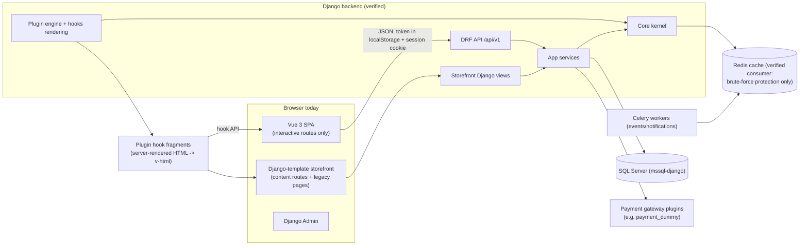
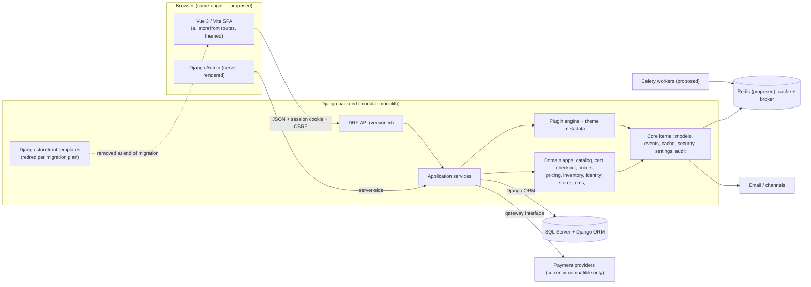
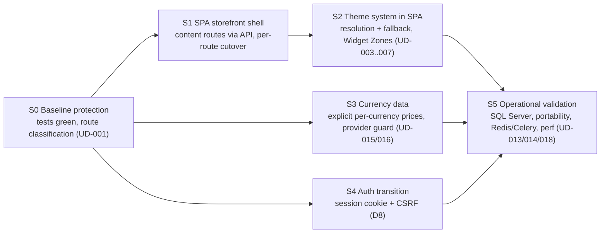

# Architecture Specification

**Document:** `specs/ARCHITECTURE.md`\
**Version:** 0.9\
**Status:** Draft — prepared for final user review. This document is **not
approved** and must not be treated as an authorization to implement.
Revision 0.9 records the user decision of 2026-10-22 on D7: Redis and Celery
are retained for V1, and operational validation is deferred to
implementation/deployment validation and must be completed before production
readiness is claimed. It also completes the section 13 traceability mapping
for FR-REP-001, FR-REV-001, TR-STACK-001, and TR-STACK-005 and registers
UD-023 in the section 12 open-decision table. No validation has been
performed, and no implementation is authorized. Revision 0.8 records the
approved 2026-10-22 decisions: the customer-owned
reusable address entity as distinct from the order address snapshot, public
brand API filtering of inactive brands, contact-inquiry storage and
notification using the existing notification capabilities, the Vue Widget
Zone rendering contract with Vitest-based verification, and the approved
Theme/Widget Zone implementation sequence. It adds no new architecture
decision beyond the approved scope and introduces no implementation.
Revision 0.7 adds §10.5, the V1 Redis/Celery resilience policy (Option B:
explicit user-decided failure handling plus accompanying architectural
recommendations), records the Transactional Outbox
deferral to a future release, and updates §10.3, §10.4, §11 (D7), §12, §13,
and §14 accordingly. D7 remained open pending operational validation at that
revision; its later disposition is recorded in revision 0.9.
Revision 0.6 aligned §10.4 with the approved 2026-10-21 release assignment
of the four capabilities, corrected verified As-Is evidence (shipping module
facts, app count), and fixed internal cross-references. Release-scope
approval of the baseline documents is not final approval of this
architecture.\
**Last updated:** 2026-10-22\
**Basis:** `PROJECT_SCOPE.md` v0.10 and `REQUIREMENTS.md` v0.12 (approved by
the user), plus direct inspection of the current repository.

## 1. Architecture Purpose and Status

### 1.1 Brownfield Context

pyStore is an **existing application** developed before Spec-Driven
Development was adopted. It is not a greenfield project: a large working
Django codebase, a Vue SPA, a plugin engine, themes, and an extensive test
suite already exist. The purpose of this document is to:

1. **Document the current system** (As-Is) based on repository evidence.
2. **Define the target architecture** (To-Be) that satisfies the approved
   scope and requirements.
3. **Describe the transitional architecture** and an incremental evolution
   strategy so the existing system can reach the target without a rewrite
   and without disrupting working functionality.

The existing code is never assumed to be wrong simply because it differs
from the target. Where the implementation conflicts with an approved
requirement, the conflict is recorded with a migration path (§5, §6);
requirements are never silently changed to match the code.

### 1.2 Labels Used in This Document

| Label | Meaning |
| --- | --- |
| **As-Is** | Verified current behavior, citing concrete repository paths |
| **To-Be** | Proposed target architecture, requiring approval |
| **Transitional** | Deliberate temporary arrangement during migration, to be retired |
| **Gap** | Distance between As-Is and To-Be |
| **Approved** | Already-approved scope/requirements constraint (not re-decided here) |
| **Unknown** | Area not yet inspected or not verifiable from evidence gathered |

### 1.3 Relationship to Other Documents

- `PROJECT_SCOPE.md` defines the approved scope and technology direction.
- `REQUIREMENTS.md` defines functional/technical/non-functional requirements
  with stable identifiers; this document shows how the architecture serves
  them (§13).
- Detailed data structures, endpoint contracts, plugin manifests, and
  deployment runbooks belong to later phases (`DATA_MODEL.md`,
  `API_SPEC.md`, `PLUGIN_SYSTEM.md`, `DEPLOYMENT.md`,
  `IMPLEMENTATION_PLAN.md`) and are deliberately not defined here.

## 2. Existing-System Summary (Evidence-Based, As-Is)

Every claim below was verified in the working tree during this revision.
Areas that could not be verified are marked **Unknown** rather than guessed.
A stale git worktree exists at `src/.kilo/worktrees/`; it is excluded from
all evidence. `src/Architcture.md` (misspelled name) is a legacy Persian
master-instruction document from the pre-SDD era (it references PostgreSQL
and a 22-phase build plan); it is **not** an approved specification and
`specs/` is authoritative (`specs/README.md` §5).

### 2.1 Django Project, Settings, and Applications

- **Verified.** Django 5.2 modular monolith under `src/` with `config/`
  (`settings/base.py`, `development.py`, `production.py`, `test.py`,
  `urls.py`, `api_urls.py`, `wsgi.py`, `asgi.py`, `celery.py`), a `core/`
  framework kernel, 18 business apps under `apps/` (identity, stores,
  vendors, catalog, inventory, pricing, cart, checkout, orders, payments,
  shipping, notifications, reviews, cms, media, search, storefront,
  admin_panel), plus `plugins/`, `themes/`, `frontend/` (As-Is). The
  `shipping` app is an API-only module that is not registered in
  `INSTALLED_APPS` (see §2.2).
- **Verified.** `config/settings/base.py`: environment-driven via
  django-environ; installed apps split into `DJANGO_APPS`, `THIRD_PARTY_APPS`
  (`rest_framework.authtoken`), `BUSINESS_APPS`, `CORE_APPS`,
  `PLUGIN_APPS` (discovered at import time via
  `core.plugins.loader.get_discovered_plugin_apps()`); middleware includes
  `apps.stores.middleware.DbLocaleMiddleware` (DB-driven translations) and
  custom `core.security.headers`/`cors` middleware; templates DIRS include
  the active theme's directory; `ACTIVE_THEME` from environment
  (`STOREFRONT_SPA_ENABLED` flag default off; SPA build served from
  `apps/storefront/static/storefront-spa`).
- **Verified.** Auth settings: `AUTH_USER_MODEL = "identity.User"`;
  `AUTHENTICATION_BACKENDS` = custom `apps.identity.backends.PermissionBackend`
  + `ModelBackend`; DRF defaults = `TokenAuthentication` + `SessionAuthentication`,
  `AllowAny` default permission class, URL-path versioning (`v1`),
  `StandardPagination`, anon/user/auth throttles, and a central exception
  handler (`core.error_handling.api_exception_handler`).
- **Partially verified.** Settings variants `development.py`, `production.py`,
  `test.py` exist; their content was not fully inspected (**Unknown** in
  detail).
- **Verified.** Database: `mssql-django` (SQL Server) with default
  `DATABASE_URL` `mssql://...ODBC+Driver+17...` (`requirements/base.txt`,
  `settings/base.py`). SQL Server version support remains unvalidated (UD-013).
- **Verified.** Redis (`django-redis`) configured as cache;
  Celery (`celery[redis]`) configured with broker/backend and beat schedule
  hook (`config/celery.py`).
- **Unknown / Missing.** No Dockerfile, docker-compose, or other deployment
  manifests were found in the repository; operational tooling is limited to
  `scripts/test.ps1` / `scripts/test.sh` and `gunicorn` in dependencies.

### 2.2 Existing Apps and Responsibilities

Model classes verified via source inspection (not an exhaustive dump —
only what materially affects architecture):

- **identity**: `User` (custom, `AbstractBaseUser` + `PermissionsMixin`),
  `Customer`, `Permission`, `Role`, `PasswordResetToken`,
  `EmailVerificationToken`; services include
  `services/authentication.py` (token issuance), registration, passwords,
  roles, verification; `backends.py` implements the permission backend.
- **stores**: `Store`, `Language`, `Currency` (with is-default behavior),
  `LocaleStringResource` (DB catalog of translations),
  `StoreDomain`; `middleware.py` locale middleware;
  `seed_translations` management command.
- **catalog**: `Product`, `ProductVariant`, `ProductAttribute`,
  `ProductAttributeAssignment`, `ProductAttributeValue`,
  `ProductVariantAttribute`, `ProductSpecification`, `ProductImage`,
  `ProductRelation`, `ProductDownload`, `ProductBundleItem`,
  `ProductSEO`, `Category`, `Brand`, `Tag`; plus `pricing.py` and
  `events.py` integration.
- **inventory**: `Warehouse`, `WarehouseLocation`, `InventoryItem`,
  `InventoryTransaction` (auditable stock movements).
- **pricing**: `PriceList`, `PriceListEntry`, `ScheduledPrice`, `Discount`,
  `DiscountUsage`, `TaxClass`, `TaxRate`, `CustomerTaxInfo`,
  `ProductTaxSetting`; `engine.py`, `discounts.py`, `taxes.py`.
- **cart**: `Cart`, `CartItem`, `WishlistItem`, `CompareItem`;
  `calculation.py` (dedicated calculation module), `wishlist.py`,
  `compare.py`, `services.py`.
- **checkout**: `pipeline.py` (`CheckoutPipeline` with ordered,
  plugin-extensible steps: ValidateCart → Customer → Address → Shipping →
  Tax → Discount → Inventory → Payment → OrderCreation), `steps.py`,
  `services.py`, `context.py`, `models.py`.
- **orders**: `Order` (with `currency` field, default `"USD"`),
  `OrderItem`, `OrderAddress`, `OrderStatusLog`, `OrderNote`, `Refund`,
  `ReturnRequest`, `ReturnRequestItem`; `state_machine.py` with validated
  order/payment/shipment transitions; `services.py` and `events.py`.
- **payments**: API layer only (`payments/api.py`); gateway logic lives in
  the plugin layer behind `core.payments.interface.PaymentGateway`.
- **shipping**: API-only module (`shipping/api.py`: `ShippingMethodsView`,
  `RatesView`, `TrackingView` with serializers); not registered in
  `INSTALLED_APPS` — its views are imported directly by
  `config/api_urls.py`. The `ShippingMethod` and `PaymentMethod` models
  live in `apps/checkout/models.py`, not in the shipping app.
- **notifications**: `NotificationTemplate`, `WebhookEndpoint`,
  `WebhookDeliveryLog`, `NotificationMessage`, `Notification`; provider
  registry integration.
- **reviews**: `ProductReview`. **cms**: `Page`, `BlogCategory`,
  `BlogPost`, `Menu`, `MenuItem`, `Widget`, `ContentBlock` (SEO mixins).
- **media**: `MediaFile` with upload safety settings. **search**: database
  backend (`SEARCH_BACKEND=database`). **vendors**: `Vendor`, `VendorUser`.
- **admin_panel**: custom `AdminSite` (`admin_site.py`), dashboard, plugin
  management pages, i18n seeded labels, custom widgets (tagify, searchable
  selects, inline dialogs), vendored Bootstrap assets.
- **storefront**: Django-template views for content routes, the SPA serving
  module (`spa.py`), plugin hook rendering (`hooks.py`), theme helpers
  (`themes.py`), context processors, template tags (`plugin_hooks`,
  `strings`), and REST support for the SPA (bootstrap, hooks, search,
  pages, blog, wishlist, compare).

### 2.3 Existing APIs, Serializers, Permissions, Authentication

- **Verified.** Versioned REST surface under `/api/<version>/`
  (`config/api_urls.py`): auth (register/login/logout/password-reset/
  verify-email), customers (`customers/me`), cart + coupon, checkout +
  methods, payments initialize, shipping methods/rates/track,
  products/categories/brands (DRF `DefaultRouter` viewsets), orders,
  reviews, webhook endpoints/delivery logs, storefront bootstrap/hooks/
  search/pages/blog/wishlist/compare.
- **Verified.** Serialization and view logic live per app (`api.py` modules);
  business rules live in services; default permission class is `AllowAny`
  with per-view restrictions (permissive-by-default is a noted risk, §10).
- **Verified (gap).** Dual authentication: login issues an API token and
  also performs Django session login; logout revokes the token and ends the
  session (`apps/identity/api.py`). The SPA keeps its token in
  `localStorage` and forwards the CSRF cookie
  (`frontend/src/api/client.js`).

### 2.4 Existing Storefront Pages, Templates, Vue/Vite/Bootstrap

- **Verified.** Django templates under `apps/storefront/templates/
  storefront/`: base, home, category, product_detail, search, cart,
  checkout, login, register, account, wishlist, compare, order_detail,
  cms_page, blog list/detail — i.e., the **content routes are still
  server-rendered** while the SPA owns interactive routes.
- **Verified.** `base.html` is RTL-aware
  (`dir="{{ storefront.active_language.direction|default:'ltr' }}"`), uses
  DB-driven translations via the `` tag, plugin fragments via the
  `` tag, and a **custom stylesheet**
  (`storefront/css/main.css`) — **no Bootstrap references found** in
  storefront templates or themes.
- **Verified.** SPA (`src/frontend/`): Vue 3, Pinia, vue-router, Vite
  (`package.json`, `vite.config.js`); router owns cart/checkout/login/
  register/account/wishlist/compare/orders routes with a not-found fallback;
  build output emitted to Django static so one origin serves SPA/API/Admin;
  dev-server proxy for `/api`, `/static`, `/admin`.
- **Partially verified.** Bootstrap: vendored in `admin_panel` (admin UI
  uses it); **not present in the storefront SPA or templates** — a gap vs.
  TR-STACK-004.
- **Partially verified.** RTL exists in both rendering paths (template
  `dir` attribute; SPA `App.vue`/`base.css`/`stores/storefront.js`
  direction handling) — completeness unverified.

### 2.5 Existing Theme and Plugin Mechanisms

- **Verified.** Plugin engine in `core/plugins/`: `plugin.json` manifests
  (`manifest.py`: id/name/version/entry_point/dependencies/
  minimum_core_version), file-location loader (`loader.py`), `PluginManager`
  with discover/install/enable/disable + dependency and version checks
  (`manager.py`), `PluginState` persistence, permission registry, service
  container, event-dispatcher integration; provider interfaces and
  registries in `core/payments`, `core/shipping`, `core/notifications`.
- **Verified.** Seven plugins under `src/plugins/`: `ajax_cart`,
  `flash_sale`, `payment_dummy`, `sample_plugin`, `shipping_dummy`,
  `slider`, `theme_pacific` (a theme-providing plugin).
- **Verified.** Themes: `src/themes/default`, `src/themes/alt-theme`
  (Django templates + `theme.json`); active theme resolved from
  `ACTIVE_THEME` env var and injected into template/static dirs
  (`settings/base.py`, `core/plugins/theme_discovery.py`,
  `apps/storefront/themes.py`).
- **Verified (gap).** Plugin storefront UI reaches the SPA as
  **server-rendered HTML fragments** (plugin Django templates rendered by
  `apps/storefront/hooks.py`, delivered via the hook API and injected with
  `v-html`) — not Vue Widget Zone components.

### 2.6 Existing Cart / Checkout / Order / Payment / Currency / Variant Functionality

- **Verified.** Variant model foundation (catalog classes in §2.2);
  cart calculation service; plugin-extensible checkout pipeline; order
  state machine; payment gateway interface
  (`core/payments/interface.py`: initialize/authorize/capture/void/refund);
  `transaction.atomic` usage in `apps/cart/services.py`,
  `apps/catalog/services.py`, `apps/checkout/models.py`,
  `apps/orders/services.py`, `apps/stores/services.py`,
  `apps/vendors/services.py`.
- **Verified (gap).** `Order.currency` and `stores.Currency` exist, but
  **no explicit per-currency product/variant price storage** and **no
  provider currency-capability data** were found — the approved
  explicit-prices-only and payment-currency rules are not yet implementable
  end-to-end (CF-008, UD-015/UD-016).
- **Verified (conflict with deferral).** `Refund`/`ReturnRequest` models
  exist although refunds are deferred (UD-017); they must remain dormant in
  V1.

### 2.7 Existing Multilingual / RTL, Tests, Migrations, Dependencies

- **Verified.** Multilingual foundation: `Language`, `LocaleStringResource`,
  `DbLocaleMiddleware`, `` tag, gettext fallback
  (`LOCALE_PATHS`), language/currency cookies, seed command; RTL direction
  attributes in template and SPA paths. Fallback rules for admin-authored
  content remain UD-010.
- **Verified.** Tests: pytest suite under `tests/` with 20+ domain
  directories (admin, api, cart, catalog, checkout, cms, core, identity,
  inventory, notifications, orders, plugins, pricing, reviews, search,
  security, storefront, stores, vendors) plus celery/errors/health tests;
  `pyproject.toml` configures pytest + ruff; migrations exist per app
  (versioned Django migrations).
- **Verified.** Dependency management: `requirements/base.txt`
  (Django 5.2, DRF, django-environ, mssql-django, redis, django-redis,
  celery[redis], gunicorn, cryptography, Pillow), `requirements/dev.txt`.
- **Verified (gap).** Frontend test tooling: the Vue project
  (`src/frontend/package.json`, §2.4) has a `build` script only and **no
  test script or test runner**. Vitest is the approved framework for Vue
  component and Widget Zone tests (approved decision 2026-10-22; NFR-TEST-001,
  AC-ZONE-003), so the harness is not yet in place.

### 2.8 Current Architecture Diagram (As-Is, Verified Only)

Everything in this diagram was verified in the working tree (§2.1–§2.7);
limited-usage and unverified paths are noted in §2.9.

### 2.9 Unknowns Requiring Further Inspection

- Full content of `settings/production.py` and `development.py` variants.
- Per-view permission coverage across all API modules (default `AllowAny`
  makes a per-endpoint audit necessary during security design).
- Extent of Redis cache usage in the main tree: the `core.cache` service is
  verified (`core/cache/service.py`) and its only verified main-tree
  consumer is `core/security/brute_force.py`; catalog/storefront caching
  usage was **not** found and may not exist yet.
- Completeness of RTL behavior across all themes/components.
- Actual `theme_pacific` and CMS/widget capabilities in depth.
- The full `docs/` directory content.

## 3. Target High-Level Architecture (To-Be — Proposed)

**Proposed target:** the same modular-monolith Django backend, evolved —
the SPA owns **all** storefront routes behind the active Vue theme; DRF API
remains the only storefront→backend contract; Django Admin stays separate;
SQL Server/Django ORM persist; Redis/Celery support caching and background
work subject to validation; plugins extend through core contracts and Vue
Widget Zones.

Dashed elements are transitional/proposed, not current behavior. The
target **keeps the existing backend business logic** — the target changes
*who renders the storefront* (SPA + themes), *how browsers authenticate*
(session cookie + CSRF, D8), and *how plugins contribute UI* (Widget
Zones), not the domain model or service layer.

## 4. Major Components and Their Responsibilities (To-Be)

| Component | Responsibility | Status | Key requirements |
| --- | --- | --- | --- |
| Vue/Vite SPA | All storefront presentation; API consumption; theme component rendering | Exists for interactive routes; **target: all routes** | TR-STACK-003/006, FR-THEME-LAYOUT-001–012 |
| Theme layer | Active theme layouts/components/assets with deterministic fallback | Proposed (Vue side missing) | FR-THEME-001–002 |
| DRF API layer | Versioned REST, serialization, throttling, error envelope | Exists | TR-STACK-002, NFR-API-001 |
| Django storefront views/templates | Content-route rendering today | As-Is; **Transitional** — retired per §6 stages | CF-002 record |
| Django Admin (`admin_panel`) | Administration interface | Exists, stays for V1 | TR-STACK-007, FR-ADMIN-001–003 |
| Business apps + services | Domain logic (catalog/variants, pricing, cart, checkout, orders, inventory, identity, stores, cms, ...) | Exists; extended for currency prices | §8, §13 traceability |
| Core kernel | Cross-cutting framework | Exists | NFR-MAINT-001 |
| Plugin engine | Discovery, lifecycle, registries, provider interfaces, hooks | Exists; Vue Widget Zone contract proposed | FR-PLUG-001, FR-EXT-001–004 |
| Identity & access | Users, customers, roles/permissions, session/token auth | Exists; session-first browser direction proposed | FR-CUST-001, NFR-SEC-001 |
| Persistence | SQL Server via Django ORM, versioned migrations | Exists; validation pending | TR-DB-001–006 |
| Redis + Celery | Cache + background tasks | Configured; **proposed, operationally unvalidated** | §10.3 |

## 5. Current-to-Target Gap Analysis

| # | Area | As-Is (evidence) | To-Be (proposed) | Migration impact |
| --- | --- | --- | --- | --- |
| G1 | Storefront route ownership | Content routes (home/category/product/search/blog/CMS) server-rendered Django templates; SPA owns interactive routes; legacy templates also remain for SPA-owned routes | SPA owns all storefront routes with uniform theme coverage | Largest work item; per-route cutover (§6) |
| G2 | Theme system | Django-template themes + env-var activation; no Vue component resolution | Vue theme packages, root layout, page/shared component resolution, asset fallback; admin-managed activation | New resolution contract (UD-002/003/004/005) |
| G3 | Widget Zones | Plugin UI as server-rendered HTML fragments via `v-html` | Vue Widget Zone registry with ordering/fallback; plugin Vue components | UD-006/007; fragments interim-supported |
| G4 | Multi-currency | `Order.currency` + `Currency` model only; no per-currency prices; no provider currency-capability data; guard flow unverified | Explicit per-currency prices; provider support validated before payment initiation; order currency preserved | UD-015/016; data + service changes |
| G5 | Browser auth | Dual token (`localStorage`) + session | Session cookie + CSRF as browser mechanism (D8) | Transition after detailed design; no code changed by this doc |
| G6 | Refund scope | `Refund`/`ReturnRequest` models exist | Dormant in V1 (UD-017); disposition decided later | Guardrails only |
| G7 | Bootstrap | Admin only; storefront uses custom CSS | Bootstrap as storefront UI baseline (TR-STACK-004) | Styles migrate with theme work |
| G8 | SQL Server validation | `mssql-django` configured | Validated backend/version + portability checks | UD-013/014 |
| G9 | Performance verification | Targets approved (NFR-PERF-001–003); no test tooling | Reproducible baseline load test + LCP lab method | UD-018 |
| G10 | Cache/jobs necessity | Redis/Celery configured; cache mainly used by brute-force protection | Validated necessity and operational design | §10.3 |
| G11 | Deployment | No manifests; gunicorn dep only | Defined topology (one origin, D14) in deployment design | Later phase |
| G12 | Brand pages | `Brand` model has name/slug/description/is_active only; `BrandViewSet` exposes all brands to anonymous list/retrieve; no storefront brand route or page | Brand listing and brand detail pages with brand logo and SEO metadata; public brand surfaces expose active brands only | FR-CAT-006 – FR-CAT-007; data model + public query behavior + new Vue routes |
| G13 | Customer address book | No customer-owned address entity; only the order-scoped `OrderAddress` snapshot; checkout collects raw address form fields | Reusable customer-owned address entity with default address, staff read-only admin access, and checkout selection copied into the order snapshot | FR-CUST-002, FR-CHK-001; new data entity + API + Vue page |
| G14 | Contact Us page | No contact route, view, or inquiry model; the CMS catch-all is not a contact page | Dedicated contact route and page with validated input, stored inquiry, and notification through the existing notification capabilities | FR-CONTACT-001; new route, page, inquiry record, notification wiring |

## 6. Incremental Evolution Strategy (Proposed)

### 6.1 Principles

- **M1 — Preserve working functionality.** Existing behavior is not touched
  without a requirement-driven reason; the app remains functional at every
  stage.
- **M2 — Reuse before rewrite.** Existing apps, services, models, APIs, and
  tests are reused; the target architecture is largely an evolution of the
  current layering (§2), not a replacement. A full rewrite is explicitly
  rejected.
- **M3 — Incremental refactoring.** Changes land in small, verifiable
  increments; no all-at-once migration of every storefront page.
- **M4 — Separate storefront migration from backend logic.** Theme/SPA
  migration consumes the existing API/services; backend business-logic
  changes (e.g., per-currency pricing) are independent workstreams.
- **M5 — Temporary ≠ target.** Every transitional arrangement (Django
  templates for content routes, server-rendered hook fragments,
  `localStorage` token) is explicitly labeled and retired by a later stage.
- **M6 — Single source of business truth.** Business rules live in backend
  services only — never duplicated in Django templates or Vue components
  (FR-THEME-LAYOUT-009, NFR-SEC-001).
- **M7 — Regression protection.** The existing per-domain test suites and
  requirement acceptance criteria (REQUIREMENTS §4) protect behavior during
  migration; route cutovers require their relevant ACs to pass first.
- **M8 — Alternatives kept open.** Where evidence is uncertain (e.g., per-
  route cutover vs. SPA-shell-with-server-fallback), options are documented
  rather than mandated.
- **M9 — Requirements conflicts documented, not absorbed.** Any conflict
  between As-Is behavior and approved requirements is recorded with a
  migration path (e.g., G4, G6, G7).

### 6.2 High-Level Migration Stages (Proposed, Not a Plan of Record)

High-level staging only; sequencing, tasks, and scheduling are
`IMPLEMENTATION_PLAN.md` work requiring separate approval.

- **S0:** keep the suite green; classify every route (Vue-covered vs.
  legacy) in the coverage record (UD-001); inventory legacy templates.
- **S1:** extend the SPA to render content routes from existing APIs;
  cut over **route by route**, keeping each Django template as fallback
  until its cutover passes acceptance (**alternative considered:** keeping
  content routes server-rendered indefinitely — rejected as a target
  because it contradicts FR-THEME-LAYOUT-001; kept only as the fallback
  during transition).
- **S2:** introduce theme resolution/fallback (UD-003/004/005) and convert
  plugin UI to Vue Widget Zones (UD-006/007); server-rendered fragments
  remain the interim mechanism until a zone's components exist.
  **Approved sequence constraint (2026-10-22; `PROJECT_SCOPE.md` §6.5,
  `REQUIREMENTS.md` §6.1 CF-010):** preliminary theme and zone groundwork
  (registry contract, resolution rules, package format, individual route
  migrations) may be prepared before the content-route migration is
  complete, but **completion of the full Theme and Widget Zone system
  follows the migration of the relevant content pages to Vue**. A zone is
  complete only when the Vue storefront renders it, including the plugin
  contribution and the no-contribution fallback (FR-EXT-001, AC-ZONE-003).
- **S3:** implement explicit per-currency price storage/resolution and
  payment-currency validation on top of existing pricing/order models
  (UD-015/016) — independent of S1/S2 (M4).
- **S4:** move browser flows to session cookie + CSRF after detailed design;
  retire the `localStorage` token for browser use.
- **S5:** validate SQL Server support/portability (UD-013/014), Redis/Celery
  operational behavior (D7 — retention decided; validation deferred to
  implementation/deployment validation and required before production
  readiness is claimed), and the performance baseline (UD-018).

## 7. Theme and Plugin Architecture (Conceptual, To-Be)

- **Theme package (proposed):** root layout, page components, shared
  components, layout variants, assets, metadata. Resolution is
  deterministic: active theme component → default component → explicit
  empty state; missing optional pieces never break a route
  (FR-THEME-LAYOUT-005). Contracts are UD-003/004/005.
- **Activation (proposed):** administrator-authorized action persisted in
  the backend (replacing the `ACTIVE_THEME` environment variable as target —
  UD-002; current env-var behavior remains functional in transition, CF-003).
- **Admin isolation (approved constraint):** themes/Widget Zones never
  control Django Admin (TR-STACK-007, FR-ADMIN-003, AC-THEME-LAYOUT-013).
- **Plugins (existing engine, evolving contracts):** the verified
  manifest/loader/manager/registry engine (§2.5) is kept (D5). Backend
  extension points (services, events, checkout steps, gateways, admin)
  already exist; the **Vue Widget Zone registry, plugin Vue component
  contract, ordering, and fallback** are proposed concepts whose exact
  definitions remain UD-006/007. Plugins reach storefront UI only through
  zones; no arbitrary core replacement (PROJECT_SCOPE §7).
- **Widget Zone rendering contract (To-Be, approved delivery obligation):
  a zone is a declared region of a Vue page or shared component that the
  storefront **actually renders**. For every route listed with a zone in
  the coverage record, the Vue storefront renders the zone region; an
  enabled plugin's contribution appears in the rendered output; a route with
  no plugin contribution renders the zone's documented empty or fallback
  state without an error (FR-EXT-001, FR-EXT-002, AC-ZONE-003). A zone that
  exists only in documentation, or a contribution that is fetched but never
  rendered, does not satisfy the requirement. Zone identifiers, capabilities,
  ordering, and conflict resolution remain UD-006/007 design decisions; the
  rendering obligation above is fixed by the approved requirements.
  **Verification:** Vue component and Widget Zone behavior is verified with
  **Vitest** as the approved frontend test framework, asserting zone
  rendering, plugin contribution, and the no-contribution fallback per
  route (NFR-TEST-001, AC-ZONE-003). The Vue project currently has no test
  script or test runner (§2.7), so the test harness is part of the work that
  the zone work must establish. The current server-rendered hook fragments
  (`apps/storefront/hooks.py`) remain the interim mechanism for a route or
  zone that has not yet been migrated and are retired per zone.
- **Trust:** themes and plugins are untrusted presentation/extension code
  until the trust model is specified (UD-011); in-process plugins hold full
  Django privileges (risk R1).

## 8. Data and Business Boundaries

- **Catalog & variants:** products with attribute combinations carrying
  combination-specific price inputs, SKU, stock linkage, images, enabled
  state (FR-CAT-002); server-side revalidation on add-to-cart and order
  placement (FR-CAT-004). Data exists (§2.2).
- **Inventory:** stock per item/warehouse with auditable transactions and
  concurrency-safe reservation inside checkout (NFR-REL-001).
- **Currency-specific explicit pricing (To-Be):** only explicitly configured
  per-currency prices are usable (FR-CUR-002/004, UD-009); no conversion or
  base-currency fallback in V1 (FR-CUR-003); unpurchasable items in a
  currency without an explicit price, with clear UI communication and no
  silent currency change (FR-CUR-004, AC-CUR-009); single-currency cart
  math (FR-CUR-005); orders preserve currency and amounts (FR-CUR-006).
  **Gap G4:** storage and guard flow not yet implemented (UD-015).
- **Cart / checkout / orders:** cart recalculated server-side
  (`apps/cart/calculation.py`); checkout is an ordered, plugin-extensible
  pipeline whose order creation is transactional and fails closed;
  order/payment/shipment transitions validated by the state machine
  (`apps/orders/state_machine.py`); customers see only their own orders
  (FR-ORD-001).
- **Payments:** attempts recorded against the order (FR-PAY-001); gateways
  are plugins behind `core.payments.interface` (existing). The **order
  currency** and the **provider's supported currencies** are distinct
  concepts: provider support for the order currency is validated before
  initiation; incompatible providers are never offered; currency/amounts
  are never converted or substituted (FR-PAY-002, AC-PAY-002/003). Provider
  capabilities are pluggable data, not platform assumptions.
- **Refunds:** deferred (UD-017); existing models stay dormant (G6).
- **Customer address book (To-Be):** a reusable, customer-owned address
  entity (FR-CUST-002) is **distinct from the order address snapshot**. The
  existing `OrderAddress` model (`apps/orders/models.py`) is an order-scoped
  snapshot of the address used for an order; it is not the customer's saved
  address and is not edited when a saved address changes. The saved-address
  entity is customer-scoped, supports a default address, is managed by the
  owning customer, and is **read-only for store staff in Django Admin** — an
  administrative boundary enforced by the admin registration, not by the
  template layer. Checkout copies the selected saved address into the order
  snapshot (FR-CHK-001, AC-CHK-002), so a later change or deletion of the
  saved address cannot alter an existing order.
- **Contact inquiries (To-Be):** a stored inquiry record for the Contact Us
  page (FR-CONTACT-001) plus a notification sent through the **existing**
  notification capabilities — `core/notifications/interface.py`
  (`NotificationProvider`, channels email/inapp/webhook/sms),
  `core/notifications/registry.py`, and the `apps/notifications` services
  (`queue_notification`, `send_message`, `NotificationTemplate`,
  `NotificationMessage`, `Notification`) with the providers in
  `apps/notifications/providers.py`. No new notification mechanism is
  introduced. The inquiry record and the notification are separate
  responsibilities: the inquiry is the durable customer-facing artifact, and
  the notification is the store-facing signal that may fail or be retried
  independently (NFR-REL-001). CAPTCHA behavior for the form remains
  governed by the open decision (UD-021).
- **Brand information and public exposure:** brand data is a reusable
  catalog entity (name, description, logo, SEO metadata — FR-CAT-007).
  Public brand surfaces (listing and detail, including their API responses)
  expose **active brands only**; inactive or unknown brands are not exposed
  publicly (FR-CAT-006, AC-CAT-006). The current `BrandViewSet`
  (`src/apps/catalog/api.py`) returns all brands for anonymous list and
  retrieve access and the current `Brand` model has no logo or SEO fields, so
  both the data model and the public query behavior require change
  (§5, G12). SEO metadata follows the existing `SEOMixin` pattern already
  used by CMS pages (`src/apps/cms/models.py`).
- **Identity & access:** custom user/customer model, roles/permissions,
  custom permission backend (§2.2); ownership isolation server-enforced.
- **Store/theme/plugin configuration:** store settings, currencies,
  languages, theme activation/settings, plugin lifecycle/settings
  administered in Django Admin; consumed via typed/encrypted settings
  services and the storefront bootstrap API; configuration changes affect
  behavior parameters and presentation, never business logic.

## 9. Authentication and Authorization Boundaries

- **Approved constraint:** authorization is enforced server-side; hiding
  frontend controls is not authorization (NFR-SEC-001, FR-ADMIN-002).
- **Proposed direction (user-approved direction, pending final architecture
  approval):** same-origin deployment (D14) with **session-cookie +
  Django CSRF** as the browser-authentication approach for storefront
  requests; all state-changing requests follow CSRF requirements; Django
  Admin remains the V1 admin interface (D8).
- **Transition gap (As-Is → To-Be):** dual token+session today with the SPA
  token in `localStorage` (§2.3, G5). Existing authentication code is not
  removed or changed by this document; the transition is future approved
  work after detailed design covers cookie security settings, HTTPS
  requirements, session expiration, login/logout behavior, and CSRF
  integration. Same-origin deployment alone does not resolve these concerns.
- **Non-browser clients / external integrations:** a separate mechanism
  (e.g., token API access) is an **open design consideration** — not
  silently extended into V1 scope (the existing DRF token infrastructure is
  candidate input, not an approved storefront contract).
- **Default permission posture risk:** DRF's default permission class is
  `AllowAny` with per-view overrides (§2.1); a per-endpoint authorization
  audit is required during security design (risk R3b in §12).
- **Customer address ownership (To-Be):** address-book reads and writes are
  enforced server-side against the authenticated customer (FR-CUST-002); the
  storefront API exposes only the requesting customer's addresses, and store
  staff receive read-only access through the Django Admin registration.
  Selecting an address that belongs to another customer at checkout is
  rejected rather than silently accepted (FR-CHK-001, AC-CHK-002). The
  per-endpoint audit in risk R3b must include the new address-book and
  contact endpoints.

## 10. Performance, Security, and Operational Considerations

### 10.1 Performance

- Approved targets NFR-PERF-001–003 are preserved unchanged (baseline load:
  100 VUs / 30 min / <1% error; API p95 targets/thresholds; LCP p75 ≤ 2.5 s
  lab-verified). This document adds no new targets.
- Architectural supports: pagination + prefetching (N+1 avoidance) on list
  endpoints; caching of hot reads (proposed — current cache usage is
  limited, G10); Vite code-split bundles (existing); background offload for
  notifications/webhooks via Celery (existing) so request paths stay lean.
- Migration-specific concern: during transition, both rendering paths must
  respect the budgets; per-route cutovers are verified against the LCP
  method (UD-018).

### 10.2 Security

- Server-side trust for all business rules (M6); upload safety, security
  headers, CORS, brute-force, SSRF modules exist (`core/security/`).
- Key risks: in-process plugin privilege (R1), untrusted theme/hook code
  with `v-html` fragments (R2), token-in-`localStorage` XSS exposure until
  the D8 transition completes (R3), permissive DRF default permissions
  (R3b).

### 10.3 Operational (Redis / Celery — V1 Retention Decided 2026-10-22; Operational Validation Deferred)

- **Distinguishing evidence from role:** Redis/Celery are *installed and
  configured* (§2.1) — installation is **not proof of architectural
  necessity** for every workflow. Verified main-tree usage is narrow
  (brute-force protection via `core.cache`; Celery used for event/notification
  tasks with an eager/test mode).
- **Decided role (user-approved 2026-10-22, D7):** Redis as the caching
  component; Celery as the background-task mechanism are retained for V1.
  Operational validation of actual need, operational complexity, deployment
  requirements, failure handling, and resource cost is **deferred to
  implementation/deployment validation** and must be completed before
  production readiness is claimed. No such validation has been performed
  yet.
- **Failure/degradation policy (user-decided, 2026-10-21):** the core V1
  failure-handling and degradation policies for Redis and Celery have been
  decided by the user and are documented in §10.5, which also records
  accompanying architectural recommendations and outstanding work. The
  policies are documentation of decided direction, not implemented
  behavior; operational validation of Redis/Celery remains outstanding and
  is deferred to implementation/deployment validation (D7, §10.3, §12, §14).
- **Consistency rule:** the architecture does not require business
  operations to run asynchronously; order placement and other critical
  operations keep their synchronous transactional behavior (NFR-REL-001).
- **Not defined here:** cache key conventions, TTL policies, Celery queue
  definitions, retry policies, worker counts, schedules — later phases.
- **Deployment:** one-origin direction (D14, proposed); no deployment
  manifests exist today (G11); the serving/reverse-proxy arrangement is a
  later deployment design decision; the Vite dev server is never assumed in
  production.

### 10.4 Newly Identified Capability Concerns (2026-10-21)

Architectural concerns for the four capabilities recorded in
`REQUIREMENTS.md` v0.12 (FR-PLUG-002, FR-EVT-001 – FR-EVT-004,
FR-CAPTCHA-001 – FR-CAPTCHA-006, FR-SMS-001 – FR-SMS-005). **Approved
release assignment (2026-10-21, CF-009):** scheduled tasks, the
event/consumer mechanism, and Google reCAPTCHA are included in V1; SMS
architectural compatibility is required in V1, with actual SMS delivery and
phone-number verification deferred to a later release. None of this is
implemented by the architecture documents; evidence classifications below
are unchanged, and no detailed design is started here. Remaining technical
decisions stay open (UD-019 – UD-022).

**Plugin-defined scheduled tasks (FR-PLUG-002, UD-019) — included in V1.**
*Verified:* Celery beat configuration hook (`CELERY_BEAT_SCHEDULE` in
`config/settings/base.py`, `config/celery.py`); a generic job-task
decorator with retries/backoff/logging (`core/jobs/base.py`); plugin
registration machinery (`core/plugins/manager.py`). *Missing:* a
plugin-facing task declaration/scheduling registry, schedule and
overlap management, and execution observability for plugin tasks.
*To-Be concern:* a central task scheduling/execution capability that
enabled plugins declare into; administration and overlap policy are open
(UD-019).

**Application events and consumers (FR-EVT-001 – FR-EVT-004, UD-020) —
included in V1.**
*Verified:* a typed in-process publish/subscribe dispatcher with
synchronous dispatch (per-handler failure logging) and Celery-based
asynchronous dispatch (`core/events/dispatcher.py`, `core/events/base.py`,
`core/events/tasks.py`, `core/events/registry.py`); domain event types
including `OrderPaid` and entity-lifecycle events such as
`ProductCreated`/`InventoryChanged` (`apps/*/events.py`); plugin
event-handler registration (`core/plugins/manager.py`). *Partial:* no
documented event catalog or publication-boundary contract; failed handlers
are logged but not retried; duplicate-delivery and transaction-consistency
policies undocumented. *To-Be concern:* the existing dispatcher is the
proposed foundation; the event catalog, publication boundaries, and
per-event delivery classification must be defined (UD-020). The V1
failure-handling, alerting, and consistency policy for asynchronous events
is user-decided and documented in §10.5.

**CAPTCHA integration (FR-CAPTCHA-001 – FR-CAPTCHA-006, UD-021) — Google
reCAPTCHA included in V1.**
*Missing:* no CAPTCHA/reCAPTCHA code, dependency, or configuration exists
anywhere inspected (src, tests, requirements, `.env.example`). *To-Be
concern:* a provider-agnostic CAPTCHA integration boundary with
server-side token verification and secure secret handling aligned to the
existing settings/credentials mechanisms (`core/settings`); form policy,
reCAPTCHA type/version, and failure policy are open (UD-021).

**SMS-compatible registration (FR-SMS-001 – FR-SMS-005, UD-022) — V1
compatibility; delivery/verification deferred.**
*Partial (verified):* the notification-provider registry supports an
`sms` channel with a logging-only placeholder provider; real SMS gateways
are expected from plugins (`core/notifications/interface.py`,
`apps/notifications/providers.py`); `identity.User.phone` exists with
validation (`apps/identity/models.py`). *Missing:* phone-verification
status, one-time-code/verification flows, and administrative activation
policies. *To-Be concern (V1 scope):* registration and identity flows must
not preclude SMS verification (compatibility only); the provider-agnostic
SMS delivery boundary is proposed to build on the existing
`NotificationProvider` registry. Actual SMS delivery and the
phone-number verification workflow are deferred to a later release;
their policy details are deferred with it (UD-022).

### 10.5 V1 Redis/Celery Resilience Policy (Option B — Decisions and Recommendations, 2026-10-21)

**Status of this section:** everything below is **unimplemented
policy** — nothing here authorizes or performs implementation. The V1
retention decision is resolved (D7, revision 0.9: Redis and Celery are
retained for V1); operational validation remains outstanding and is deferred
to implementation/deployment validation, to be completed before production
readiness is claimed (§10.3, §12, §14). Three
classifications are used:

1. **Explicit user decisions (confirmed 2026-10-21):** retain Redis and
   Celery for V1, with operational validation deferred to
   implementation/deployment validation and required before production
   readiness is claimed; continue login during
   Redis outages with an operational alert and visible reduction of
   brute-force protection; keep the API available during Redis
   rate-limiting outages with an operational alert and visible reduction
   of protection; log and alert on asynchronous event enqueue failures
   with recovery appropriate to the event type; no guaranteed event
   delivery or automatic replay in V1; a failed search-index enqueue must
   not invalidate a successful product save (the existing reindex
   capability recovers the index); schedule the existing notification
   recovery/sweep tasks in V1; defer the Transactional Outbox and
   equivalent durable event-recovery mechanisms to a future release.
2. **Architectural recommendations (target principles, not separately
   confirmed user decisions):** worker/Celery Beat health observability
   and alerting, and the general-cache degradation behavior (10.5.1).
3. **Outstanding:** implementation, detailed design (intervals, retry
   tuning, alert routing, mechanisms — §10.5.4), and operational
   validation.

In the matrix below, "As-Is" records verified current behavior (paths
under `src/`, §2.1); "V1 target policy" records decided or recommended
direction as marked per row.

#### 10.5.1 Per-Use Failure Policy Matrix

| Concern | As-Is behavior (verified) | V1 target policy |
| --- | --- | --- |
| Login / brute-force protection (`core/security/brute_force.py`, `apps/identity/services/authentication.py`) | Failed-login counters live in the Redis cache; counting errors are swallowed silently, while the lock check propagates cache errors — a Redis outage can fail login requests with a server error | **User decision:** If Redis is unavailable during login, login attempts continue; an operational alert is raised. Reduced brute-force protection must not be silently ignored |
| DRF rate limiting (`config/settings/base.py` throttle defaults; `apps/identity/api.py` `auth` scope) | Throttle counters are stored in the default Redis cache; a cache failure propagates into API requests | **User decision:** API availability is preserved; an operational alert is raised because protection is reduced |
| General caching (`core/cache/service.py`) | Cache errors propagate to callers; no automatic fallback to the underlying data source and no cache-failure alerting exist | **Recommended (not a confirmed user decision):** requests would degrade to the underlying data source and cache unavailability would be alerted. Proposed target policy only; unimplemented |
| Asynchronous domain events (`core/events/dispatcher.py`, `core/events/tasks.py`) | `dispatch_async` calls `.delay()` without error handling; handler failures are logged but not retried | **User decision:** Enqueue failure must not invalidate an otherwise successful committed business transaction: failures are logged with context, alerted, and recovered per event type (10.5.2); no guaranteed delivery or automatic replay is promised |
| Order events and order consistency (`apps/checkout/services.py`, `apps/orders/services.py`) | Order-created dispatch runs inside the checkout transaction (a broker failure can roll back the order); status-transition events are dispatched after non-atomic saves (a broker failure loses the event) | **User decision:** A committed order is never lost because event enqueueing fails; enqueue failures are logged with context and alerted (10.5.2) |
| Search indexing (`apps/search/signals.py`, `apps/search/tasks.py`) | The post-save enqueue is unguarded; index tasks have no retries; `reindex_search_task` provides a full reindex | **User decision:** If search-index enqueueing fails, product creation/update still succeeds; recovery uses the existing reindex capability |
| Notification delivery and recovery (`apps/notifications/services.py`, `apps/notifications/tasks.py`) | Messages are persisted as DB rows and enqueued at commit with bounded retries; the two recovery sweep tasks exist but have no registered schedule | **User decision:** Notification delivery stays DB-backed with bounded retries; the recovery/sweep tasks are scheduled for V1 (10.5.4) |
| Webhook delivery (`apps/notifications/webhooks.py`) | Per-attempt durable delivery logs, bounded retries, signed payloads, SSRF validation; a failed retry enqueue drops the remaining retries for that delivery | **As-is (no change):** Retained as-is; the retry-enqueue limitation is documented, not presented as fixed |
| Worker / Beat health (`core/health/checks.py`) | The health endpoint checks application, database, and Redis only; no worker or Beat visibility exists | **Recommendation (target principle, not a confirmed user decision):** Worker and Celery Beat health should be observable and alertable; the monitoring mechanism is detailed design (10.5.4) |
| Plugin-defined scheduled tasks (FR-PLUG-002, UD-019) | No plugin-facing task registry exists yet | **Existing decisions apply:** Follows the plugin architecture decisions already in this document (§10.4); no new registry or implementation detail is introduced here |

#### 10.5.2 Event Consistency Without Transactional Outbox (V1 Limitations)

- **No rollback for enqueue failure.** Failure to enqueue an asynchronous
  event must not roll back or invalidate an otherwise successful, committed
  business transaction (consistent with the §10.3 consistency rule and
  NFR-REL-001).
- **Investigation and alerting.** Enqueue and handler failures must be
  logged with enough context (event name, payload or correlation
  identifiers, error detail) for investigation and must raise an
  operational alert.
- **Recovery is event-specific and best-effort.** Recovery uses mechanisms
  that already exist or are scheduled by 10.5.4 — notification recovery
  sweeps, the search reindex task, and manual reconciliation from order
  status and audit records. Recovery must not be represented as guaranteed.
- **No delivery guarantees.** V1 does not guarantee event delivery,
  exactly-once handling, or automatic replay — consistent with FR-EVT-004
  and the approved release assignment in `PROJECT_SCOPE.md` §3.
- **Transactional Outbox is deferred to a future release** by user
  decision. It is not a V1 requirement, must not be implemented as part of
  V1, and no alternative mechanism (for example a durable event table,
  journal, or relay process) may be introduced in V1 in a way that
  silently recreates the deferred Outbox capability. This deferral is
  recorded here only; the approved scope and requirements documents are
  not modified by this revision.

#### 10.5.3 Security Degradation Principle

- **Security controls must not silently degrade.** When Redis-dependent
  brute-force protection or rate limiting is unavailable, the selected V1
  behavior preserves login/API availability and emits an operational
  alert; the reduced protection must be made visible to operators.
- **No unverified fallback may be claimed.** No proxy, WAF, local limiter,
  or other fallback mechanism may be asserted unless verified as existing —
  none exists in the repository today (§2.9, G11).
- Implementation and alerting details belong to detailed design.

#### 10.5.4 Scheduling and Monitoring (Policy Level)

- The existing notification recovery/sweep tasks
  (`apps/notifications/tasks.py`) are **scheduled for V1** by user
  decision. Exact schedule intervals, overlap handling, idempotency,
  retry tuning, queue topology, and alert-routing implementation belong to
  detailed design.
- Worker and Celery Beat health observability and alerting is an
  **architectural recommendation (target principle)**, not a confirmed
  user decision and not implemented; the monitoring mechanism belongs to
  detailed design.
- Plugin-defined scheduled tasks follow the project's existing plugin
  architecture decisions (§10.4, UD-019); this document adds no new
  registry or implementation detail.

## 11. Architecture Decision Table

Approved constraints (this document's §2.1: Django/DRF, Vue/Vite, Bootstrap,
Django Admin for V1, SQL Server, Django ORM, portability, plugins/themes,
i18n/RTL, variants, explicit currency prices, refund deferral,
payment-currency rule, performance targets) are not re-decided. Statuses
below are **proposed / pending final architecture approval** unless noted.

| # | Decision | Proposal | Rationale | Alternatives | Status |
| --- | --- | --- | --- | --- | --- |
| D1 | System style | Modular monolith (existing) | Working As-Is; scope excludes microservices; simplest consistency model | Microservices (rejected); front/back repo split for deploy (deployment design) | Proposed (evolution, not rewrite — M1/M2) |
| D2 | Layering | API → service → model with core kernel | Matches verified code; testability | Fat models / views logic (rejected) | Proposed (formalization of existing) |
| D3 | Storefront rendering | SPA owns all routes as target; Django templates transitional, retired per route | FR-THEME-LAYOUT-001; SSR excluded by scope | Permanent hybrid (rejected as target); SSR (not approved) | Proposed; sequencing = UD-001 |
| D4 | Theme mechanism | Vue theme packages; deterministic resolution + default fallback | FR-THEME-LAYOUT-005; partial overrides supported | Django-template themes for SPA (rejected by scope); remote runtime themes (rejected: security/complexity) | Proposed; details UD-003/004/005 |
| D5 | Plugin engine | Keep existing engine (verified §2.5); add Vue Widget Zone contracts | Tested; satisfies FR-PLUG-001 | External process isolation (not for V1; revisit UD-011) | Proposed |
| D6 | Providers | Payment/shipping/notification implementations as plugins behind core interfaces | Existing; extensibility approved | Hardcoded integrations (rejected) | Proposed |
| D7 | Cache & background jobs | Retain Redis (cache) + Celery (tasks) | Existing wiring; offload supports perf targets | DB-only cache / fully synchronous (insufficient for targets); other brokers (no need shown) | **Resolved — user-approved 2026-10-22: retain for V1.** Operational validation is deferred to implementation/deployment validation and must be completed before production readiness is claimed (§10.3, §10.5); no validation has been performed |
| D8 | Browser authentication | Same-origin **session cookie + CSRF**; server-side enforcement; token in `localStorage` retired for browser flows after design | User-approved direction; aligns with Admin session model; removes `localStorage` XSS surface (G5) | DRF token `localStorage` (current As-Is — rejected as target); JWT-only; separate non-browser mechanism (open consideration) | **Proposed — pending final approval**; detailed design later |
| D9 | API versioning | URL-path `v1` | Existing | Header/media-type versioning (no need) | Proposed |
| D10 | Error handling | Central DRF exception handler + error envelope | Existing | Per-view ad hoc (rejected) | Proposed |
| D11 | Base model/IDs | `BaseModel` (timestamps, UUID-capable), soft delete where configured | Existing | UUID-only PKs (detail design) | Proposed baseline |
| D12 | Search | Database backend with adapter boundary | Existing `SEARCH_BACKEND=database` | Elasticsearch/OpenSearch (deferred) | Proposed |
| D13 | Media storage | Django storage API, local filesystem default | Existing | S3-compatible (future option) | Proposed baseline |
| D14 | Initial deployment | **One origin** for SPA + API + Admin; logical separation; Vite is dev/build tool only | Simplifies cookies/CSRF/CORS; single unit; brownfield-friendly (M1) | Separate frontend host/CDN (not mandated); microservices (rejected) | **Proposed — pending final approval**; proxy/topology later |

## 12. Open Decisions and Risks

Tracked against `REQUIREMENTS.md` §6 (authoritative identifiers):

| ID / item | Decision | Resolve by |
| --- | --- | --- |
| UD-001 | Route classification & migration mapping | Architecture/design |
| UD-002 | Theme activation persistence/invalidation | Architecture/design |
| UD-003–005 | Theme resolution contract, package layout, layout variants | Architecture/design |
| UD-006–007 | Plugin Vue component contract; Widget Zone registry/ordering | Architecture/design |
| UD-010 | Translation fallback/content localization | Architecture/design |
| UD-011 | Theme/plugin trust and security model | Architecture/design |
| UD-013/014 | SQL Server version validation; portability checks | Architecture/design |
| UD-015 | Per-currency price storage/resolution | Architecture/design |
| UD-018 | Performance test environment/tooling/workload | Architecture & implementation planning |
| UD-019 | Scheduled-task administration/overlap policy (release assignment resolved: V1) | Detailed design |
| UD-020 | Event catalog, publication boundaries, delivery guarantees per event type (release assignment resolved: V1; V1 failure-handling/alerting policy decided — §10.5) | Detailed design |
| UD-021 | CAPTCHA form policy, reCAPTCHA type/version, failure policy (release assignment resolved: V1) | Detailed design |
| UD-022 | SMS: release assignment resolved (V1 compatibility; delivery/verification deferred); future policy details open | When the deferred release is planned |
| — | Cookie security/HTTPS/expiration/CSRF integration detail (follows D8) | Detailed design |
| — | Non-browser client authentication mechanism | Open consideration |
| — | Redis/Celery operational validation (D7 — retention resolved 2026-10-22): failure/degradation policies documented (§10.5 — user decisions plus recommendations); runtime validation evidence still outstanding and not yet performed | Implementation/deployment validation, before production readiness is claimed |
| UD-023 | Contact inquiry administration, retention, and notification recipient/channel configuration (FR-CONTACT-001, FR-NOTIF-001) | Detailed design |
| — | Final serving/reverse-proxy arrangement (within D14) | Deployment design |
| — | `apps.shipping` disposition: API-only unregistered module; `ShippingMethod`/`PaymentMethod` models live in `apps/checkout/models.py` (§2.2). Whether shipping becomes a registered bounded module or is consolidated under checkout | Detailed design |
| — | Disposition of dormant refund/return models | Detailed design (UD-017 guardrail) |

Risks: R1 in-process plugin privilege; R2 untrusted theme/hook fragments
(`v-html`); R3 `localStorage` token XSS until D8 transition; R3b permissive
DRF default permissions require per-endpoint audit; R4 `mssql-django`
maturity/version differences; R5 double rendering paths during migration
(mitigated by per-route cutover, M7); R6 payment provider variance;
R7 boundary erosion over time; R8 performance targets on realistic data
volumes; R9 Redis/Celery operational cost; R10 same-origin concentration of
SPA/API/Admin.

## 13. Requirements Traceability

Component→requirement mapping (IDs from `REQUIREMENTS.md` v0.12,
approved; all exist there):

| Architecture element | Requirements |
| --- | --- |
| Backend stack (Python/Django) and DRF API, versioning, error envelope (§2.1, §2.3, D9, D10) | TR-STACK-001–002, NFR-API-001 |
| Vue/Vite SPA, target route ownership (§3, D3) | TR-STACK-003, TR-STACK-006, FR-THEME-LAYOUT-001, FR-THEME-LAYOUT-009 |
| Bootstrap (G7) | TR-STACK-004 |
| Django Admin (§2.1, §4) | TR-STACK-007, FR-ADMIN-001–003, AC-ADMIN-003, AC-THEME-LAYOUT-013 |
| Theme architecture (§7) | FR-THEME-001–002, FR-THEME-LAYOUT-001–012 |
| Plugin engine / Widget Zones (§7) | FR-PLUG-001, FR-EXT-001–004, AC-ZONE-003 |
| Catalog & variants (§8) | FR-CAT-001–005 |
| Brand pages and brand data (§8, G12) | FR-CAT-006–007, AC-CAT-006–007 |
| Inventory (§8) | FR-CAT-004, NFR-REL-001 |
| Pricing / explicit currency / i18n (§8, §2.7) | FR-CUR-001–007, FR-SET-001, FR-DISC-001, FR-I18N-001–003 |
| Cart / checkout / orders / payments (§8) | FR-CART-001, FR-CHK-001, AC-CHK-001 – AC-CHK-002, FR-ORD-001, FR-PAY-001–002, FR-SHIP-001, NFR-REL-001 |
| Identity & access (§9) | FR-CUST-001–002, AC-CUST-002, NFR-SEC-001, FR-ADMIN-002 |
| Contact inquiries and notification (§8, G14) | FR-CONTACT-001, AC-CONTACT-001, FR-NOTIF-001, NFR-REL-001 |
| Reviews, reports, and audit (existing modules; §2.1, §2.2, §4 core kernel) | FR-REV-001, FR-REP-001 |
| Persistence strategy (§2.1) | TR-DB-001–006, TR-STACK-005 |
| Performance (§10.1) | NFR-PERF-001–003, AC-PERF-001–003 |
| Scheduled tasks / events / CAPTCHA / SMS concerns (§10.4; resilience §10.5) | FR-PLUG-002, FR-EVT-001–004, FR-CAPTCHA-001–006, FR-SMS-001–005 |
| Core kernel / boundaries (§4) | NFR-MAINT-001, NFR-EXT-001, NFR-TEST-001 |
| Deferred items (§8) | FR-CUR-003, FR-CUR-008 (AC-CUR-003, AC-CUR-008) |
| Accessibility (UI-level, later specs) | NFR-ACC-001 |

Per-feature acceptance criteria (AC-*) verify behavior at implementation
time via the requirement groups above; no requirement IDs were invented.

## 14. Architecture Review and Approval Checklist

- [ ] Brownfield framing accepted: evolution of the existing system, no
      rewrite (M1–M3).
- [ ] As-Is evidence summary (§2) reviewed; unknowns (§2.9) acceptable or
      assigned for inspection.
- [ ] Gap analysis G1–G11 (§5) acknowledged as planned work.
- [ ] Incremental strategy and stages S0–S5 (§6) accepted as direction
      (detailed plan separately approved later).
- [ ] Target architecture (§3, §4) accepted.
- [ ] Same-origin deployment direction (D14, §10.3) accepted.
- [ ] Session-cookie + CSRF browser-auth direction (D8, §9) accepted;
      detailed security design deferred.
- [ ] Redis/Celery retention (D7) accepted (resolved 2026-10-22: retain for
      V1); operational validation deferred to implementation/deployment
      validation and required before production readiness is claimed (§10.3).
- [ ] Redis/Celery V1 resilience policy (§10.5: explicit user decisions
      plus accompanying architectural recommendations) reviewed and
      accepted as documented direction, including the Transactional
      Outbox deferral to a future release and the V1 event-consistency
      limitations (10.5.2). This item
      does not complete the outstanding operational validation, which
      remains a prerequisite for claiming production readiness.
- [ ] Theme/plugin direction (§7) accepted as basis for UD-002–007.
- [ ] Currency/order-currency boundaries (§8) confirmed as architecture
      guards for FR-PAY-002 / FR-CUR-*.
- [ ] Decision table D1–D14 (§11) reviewed; conflicts flagged.
- [ ] Open decisions and risks (§12) assigned resolution points.
- [ ] Requirements conflicts (G4, G6, G7) acknowledged with migration paths
      — no baseline change made silently.
- [ ] Newly identified capability concerns (§10.4: plugin scheduled tasks,
      events/consumers, CAPTCHA, SMS-compatible registration) reviewed with
      the approved release assignment (2026-10-21: first three in V1; SMS
      compatibility in V1, delivery/verification deferred) and the
      remaining technical questions (UD-019 – UD-022) assigned resolution
      points.

Approval of this document authorizes detailed design (SDD Phase 4) only;
implementation remains gated per `specs/README.md` §7.

---

**End of document.**
