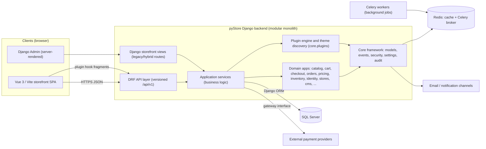
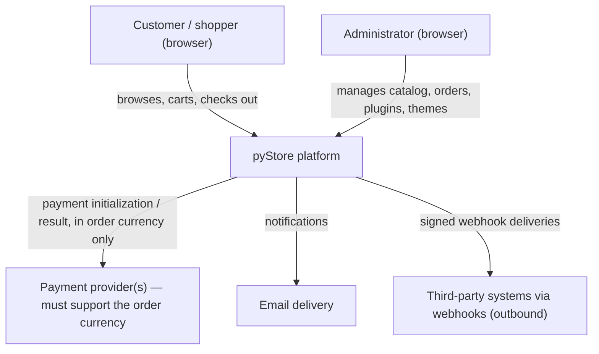
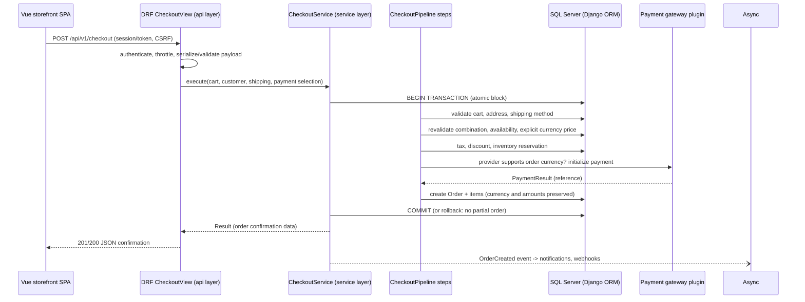

# Architecture Specification

**Document:** `specs/ARCHITECTURE.md`\
**Version:** 0.1\
**Status:** Draft — proposed for user review. This document is **not approved**.
It is a proposal for SDD Phase 3 (Architecture) and must not be treated as an
authorization to implement.\
**Last updated:** 2026-10-20\
**Basis:** `PROJECT_SCOPE.md` v0.7 and `REQUIREMENTS.md` v0.8 (both Draft).
Approved technology constraints are marked **Approved**; design choices made
in this document are marked **Proposed** and require explicit user approval.
Repository observations are marked **Evidence** and describe current behavior,
not intended behavior.

## 1. Purpose and Relationship to Other Documents

This specification defines the system's high-level structure: component
responsibilities, boundaries, communication patterns, and major trade-offs.

- `PROJECT_SCOPE.md` defines *what* the platform is and which technology
  decisions are approved. This document must not widen that scope.
- `REQUIREMENTS.md` defines *what the system must do* (functional,
  technical, and non-functional requirements with stable identifiers). This
  document explains *how the system will be shaped* so those requirements can
  be satisfied.
- Detailed data structures, endpoint contracts, plugin manifests, and
  deployment runbooks belong to later detailed-design documents
  (`DATA_MODEL.md`, `API_SPEC.md`, `PLUGIN_SYSTEM.md`, `DEPLOYMENT.md`,
  `IMPLEMENTATION_PLAN.md`). This document deliberately does not define them.

**Normative language.** "Approved" restates an already-approved decision and
must not be re-litigated here. "Proposed" is a recommendation awaiting user
approval. "Open" is a decision that must be resolved before or during detailed
design; options are listed where known.

## 2. Architectural Goals and Constraints

### 2.1 Approved Constraints (from PROJECT_SCOPE §2, §8–§9 and REQUIREMENTS §2)

| Constraint | Source |
| --- | --- |
| Python + Django backend; DRF API-first | TR-STACK-001, TR-STACK-002 |
| Separate Vue.js/Vite storefront consuming the DRF API; client-side rendering only (no SSR) | TR-STACK-003, TR-STACK-006 |
| Bootstrap for the storefront and custom UI; Django Admin keeps built-in styling in V1 | TR-STACK-004, TR-STACK-007 |
| SQL Server is the initial database; PostgreSQL only a potential future target | TR-STACK-005, TR-DB-001 |
| Django ORM only; no second ORM; database-specific behavior isolated | TR-DB-002, TR-DB-003 |
| Database portability is a design goal, never assumed configuration-only | TR-DB-006 |
| Plugin-based extensibility and a Vue theme system with fallback behavior | FR-PLUG-001, FR-THEME-001–002, FR-EXT-001–004, FR-THEME-LAYOUT-001–012 |
| Multilingual and RTL support | FR-I18N-001–003 |
| Product variants with combination-specific price, SKU, stock, images, enabled state | FR-CAT-002–004 |
| V1 uses only explicitly configured per-currency prices; no automatic conversion | FR-CUR-002–004, UD-009 |
| Refunds deferred to a future release | FR-CUR-008, UD-017 |
| Payment providers must support the order currency; order currency never silently changed | FR-PAY-002, FR-CUR-006–007, UD-016 |
| Approved V1 performance targets (baseline load test, API p95 targets/thresholds, LCP p75) | NFR-PERF-001–003, AC-PERF-001–003 |

### 2.2 Architectural Goals

1. **Modular monolith.** One deployable Django backend with strict internal
   module boundaries; no microservices-first architecture (scope exclusion).
2. **API-first storefront.** The Vue/Vite storefront owns all customer-facing
   presentation and consumes the versioned DRF API.
3. **Extensibility without core edits.** Plugins and themes extend behavior
   through documented contracts and extension points
   (NFR-EXT-001, NFR-MAINT-001).
4. **Server-side trust.** Business rules, validation, and authorization are
   enforced in Django, never in the SPA (NFR-SEC-001, FR-CAT-004).
5. **Failure-safe state transitions.** Cart-to-order, inventory, and payment
   operations are transactional and validated (NFR-REL-001).
6. **Measurable performance.** The architecture must make the approved
   baseline load test and targets reproducible (NFR-PERF-001–003).
7. **Portability by isolation.** Backend-specific SQL and settings are
   isolated behind documented boundaries (TR-DB-003, TR-DB-006).

### 2.3 Architectural Non-Goals (V1)

- SSR or a second rendering path for the storefront.
- Refund processing, automatic currency conversion, PostgreSQL migration.
- Multi-vendor marketplace as a storefront concept (vendor data models exist
  as implementation evidence; marketplace scope is excluded by
  `PROJECT_SCOPE.md` §9).
- Replacing Django Admin with a Vue administration interface.

## 3. High-Level Architecture Overview

**Proposed shape:** a modular-monolith Django backend exposing a versioned
HTTP API consumed by an independent Vue/Vite SPA, plus a server-rendered
Django Admin, over SQL Server, with Redis (cache / Celery broker) as
supporting infrastructure and a plugin/theme layer for extensibility.



Key points:

- The **SPA is the storefront presentation layer**; it never implements
  business rules (FR-THEME-LAYOUT-009). All pricing, cart, checkout, and
  order logic runs behind the API.
- **Django Admin** is a separate server-rendered interface for the initial
  release (TR-STACK-007); storefront themes and Widget Zones do not control
  it (FR-ADMIN-003, AC-THEME-LAYOUT-013).
- The **plugin engine** runs in-process inside the Django backend; plugins
  contribute services, gateways, event handlers, admin pages, and storefront
  UI fragments through registries.
- **Redis/Celery** appear in the current codebase as cache and background-job
  infrastructure (Evidence). Their production deployment role is an **open
  decision** (§17, §18).

## 4. System Context and External Actors



Actors and external systems:

- **Customer (anonymous or authenticated):** browses catalog, manages cart,
  checks out, views own orders. Data isolation between customers is a
  requirement (FR-CUST-001, FR-ORD-001).
- **Administrator:** manages the platform exclusively through Django Admin in
  V1 (FR-ADMIN-001–002).
- **Payment providers:** external. The platform validates that a provider
  supports the order currency *before* payment initiation and never changes
  the order currency to fit a provider (FR-PAY-002, AC-PAY-002/003).
  Provider-specific capabilities are pluggable data, not hardcoded platform
  knowledge.
- **Email/notification channels:** outbound; delivery via configured channels
  (FR-NOTIF-001).
- **Webhook consumers:** systems registered by administrators receiving
  signed event deliveries (existing implementation evidence).
- **Exchange-rate providers: none in V1.** Automatic conversion is deferred
  (FR-CUR-003, UD-009); the context contains no rate source.

## 5. Major Components and Responsibilities

| Component | Responsibility | Key requirements |
| --- | --- | --- |
| **Vue/Vite storefront SPA** | Presentation, route handling, client state, API consumption, theme component rendering | TR-STACK-003, FR-THEME-LAYOUT-001–012 |
| **Theme layer (SPA + backend metadata)** | Active theme resolves layouts, page components, shared components, assets with fallback | FR-THEME-001–002, FR-EXT-001 |
| **DRF API layer** | Versioned REST endpoints, serialization, throttling, error format | TR-STACK-002, NFR-API-001 |
| **Django storefront views (transitional)** | Server-rendered content routes during the migration gap; SPA bootstrapping | CF-002 gap record (REQUIREMENTS §5.2) |
| **Django Admin (`admin_panel`)** | Administration interface: catalog, orders, plugins, themes, settings, reports, audit | FR-ADMIN-001–003 |
| **Business apps (Django)** | Domain logic per bounded area (§13) | FR-CAT/CART/CHK/ORD/PAY/SHIP/DISC/SET/I18N/CUR/REV/NOTIF/REP |
| **Core framework (`core`)** | Cross-cutting: base models, services/result pattern, events, cache, security, settings, audit, plugin engine | NFR-MAINT-001 |
| **Plugin engine** | Discovery, manifest parsing, lifecycle (install/enable/disable), service and permission registries, provider interfaces (payment/shipping/notification), hook rendering | FR-PLUG-001 |
| **Identity & access** | Custom user model, customers, roles/permissions, auth backends, password/email tokens | FR-CUST-001, FR-ADMIN-002, NFR-SEC-001 |
| **Persistence** | SQL Server via Django ORM, versioned migrations | TR-DB-001–006 |
| **Background jobs** | Celery tasks for async work (notifications, webhooks, events) | FR-NOTIF-001 (delivery channels) |
| **Cache** | Redis-backed caching with namespace/invalidation service | NFR-PERF-001 support |

## 6. Application Boundaries and Communication Patterns

### 6.1 Boundary Rules

**Proposed** boundary rules (consistent with the existing layered code):

1. **API layer** (DRF views/viewsets, serializers): HTTP concerns only —
   authentication, request parsing, serialization, response codes. No
   business decisions.
2. **Service layer** (per-app `services.py`): all business rules, validation
   beyond field format, cross-app orchestration, transaction boundaries.
3. **Model layer**: persistence, invariants expressible at the data level,
   querysets. No HTTP or cross-app orchestration.
4. **Core** provides reusable abstractions; it must not import business apps
   (dependency direction: apps → core, never core → apps).
5. **Plugins** depend on core contracts only; core must not depend on
   specific plugins.

### 6.2 Communication Patterns

- **Browser → API:** HTTPS + JSON, URL-path versioned (`/api/v1/`), DRF
  token or session authentication, CSRF-protected for session flows,
  standardized error envelope via the central exception handler,
  paginated collections (Evidence; final contract details are detailed-design
  material, NFR-API-001).
- **Service → service:** direct Python calls within the monolith; cross-app
  behavior through services and the event dispatcher, not models of another
  app reaching into business logic.
- **In-process events:** domain events (e.g., order created) dispatched
  synchronously or via Celery to registered handlers, including plugin
  handlers (Evidence: `core.events`).
- **Backend → external providers:** only through provider interfaces
  registered by payment/shipping/notification plugins (§13.4).
- **Backend → plugins:** registry lookups (services, gateways, hooks,
  permissions) mediated by the plugin manager.
- **SPA → plugin UI:** server-rendered hook fragments delivered over the
  storefront hook API and injected via `v-html` today (Evidence). The target
  is plugin-contributed Vue components in Widget Zones (FR-EXT-001); the
  migration contract is an **open decision** (UD-006, UD-007).

### 6.3 Representative Request Flow

Order placement (checkout), showing the proposed/observed flow from the SPA
through the API to services and persistence. It illustrates boundaries, not a
complete contract:



Qualifications:

- **Payment timing:** order-placement API timing excludes external
  payment-provider processing time and other documented external delays
  (NFR-PERF-002). Where the API design requires an external call, the
  boundary above shows where the exclusion applies.
- Payment result handling (e.g., provider redirects/callbacks) is
  detailed-design material and is not fixed here.
- Sensitive operations run inside a single transaction so that failures never
  leave contradictory order, inventory, or payment state (NFR-REL-001,
  Evidence: `transaction.atomic` usage in cart/checkout/orders services).

## 7. Current Implementation Snapshot (Repository Evidence)

This section distinguishes what exists, what is proposed, and the gaps. It is
a snapshot of the working tree at the time of writing and makes no claim that
proposed components exist.

### 7.1 Verified in Source Code

- **Django 5.2 modular monolith** under `src/` with `config/` (settings
  package base/development/production/test, root/api URLs, Celery app),
  `core/` framework, 17 business apps under `apps/`, `plugins/`, `themes/`,
  `frontend/` (Evidence).
- **SQL Server** as configured database (`mssql-django` in
  `requirements/base.txt`, default `DATABASE_URL` is `mssql://...` with ODBC
  Driver 17) (Evidence; version support still unvalidated — UD-013).
- **Redis** cache (`django-redis`) and **Celery** workers/broker configured
  in settings (Evidence).
- **DRF** with JSON renderer, token + session authentication, URL-path
  versioning (`v1`), standard pagination, anon/user/auth throttles, central
  exception handler (Evidence: `config/settings/base.py`).
- **Versioned API surface** `/api/<version>/` covering auth, customers, cart,
  checkout, payments initialization, shipping, products/categories/brands,
  orders, reviews, webhooks, storefront bootstrap/hooks/search/pages/blog/
  wishlist/compare (Evidence: `config/api_urls.py`).
- **Custom identity**: `identity.User` (email-based), `Customer`, `Role`,
  `Permission`, password-reset/email-verification tokens, `PermissionBackend`
  (Evidence).
- **Catalog domain**: `Product`, `ProductVariant`, attributes/assignments/
  values, variant-attribute links, specifications, images, relations,
  downloads, bundle items, SEO (Evidence) — the data foundation for variants
  (FR-CAT-002).
- **Inventory domain**: warehouses, `InventoryItem`, `InventoryTransaction`
  (Evidence).
- **Pricing domain**: `PriceList`/`PriceListEntry`, `ScheduledPrice`,
  `Discount`/`DiscountUsage`, `TaxClass`/`TaxRate`, per-product tax settings
  (Evidence). **No explicit per-currency price storage found** — `stores.
  Currency` exists and `Order.currency` is stored, but product/variant prices
  are not per-currency (gap, CF-008/UD-015).
- **Cart/checkout/orders**: cart models + calculation module; checkout
  pipeline with ordered steps (validate → customer → address → shipping →
  tax → discount → inventory → payment → order creation) extensible by
  plugins; `OrderStateMachine` with validated transitions; `transaction.
  atomic` used in cart/checkout/orders services (Evidence).
- **Plugin engine**: `plugin.json` manifest (id/name/version/entry_point/
  dependencies/minimum_core_version), file-location loader, `PluginManager`
  (discover/install/enable/disable), `PluginState` persistence, service
  container, event dispatcher integration, permission registry, payment/
  shipping/notification provider interfaces and registries in `core`
  (Evidence). Sample plugins: `payment_dummy`, `shipping_dummy`,
  `ajax_cart`, `flash_sale`, `slider`, `sample_plugin`, `theme_pacific`
  (Evidence).
- **Theme discovery (Django-template era)**: `themes/default` and
  `themes/alt-theme` provide Django templates + `theme.json`; active theme
  from `ACTIVE_THEME` env var injects template/static dirs; themes can be
  supplied by plugins (Evidence).
- **Vue 3 SPA** (`src/frontend`): Vue 3, Pinia, vue-router, Vite; build output
  emitted into `apps/storefront/static/storefront-spa`; Django serves
  `index.html` for interactive routes when `STOREFRONT_SPA_ENABLED`; SPA owns
  cart/checkout/login/register/account/wishlist/compare/orders routes;
  content routes (home/category/product/search/blog/CMS) are still
  server-rendered Django templates (Evidence — the CF-002 hybrid gap).
- **Plugin hooks for the SPA**: hook fragments rendered server-side from
  plugin Django templates and delivered through the storefront hook API
  (Evidence) — not yet Vue Widget Zone components.
- **Django Admin customization**: custom `AdminSite`, group navigation, i18n
  seeded labels, widgets (tagify, searchable selects, inline dialogs) with
  vendored Bootstrap (Evidence).
- **Extensive test suite** per domain plus `test_security`, `test_plugins`
  (Evidence).
- **`src/Architcture.md` (misspelled name)** is a historical Persian
  master-instruction document describing build phases (it references
  PostgreSQL as database). It predates the specs and is **not** an approved
  specification; `specs/` is authoritative (README §5). It was not modified.

### 7.2 Proposed by This Document (Not Fully Implemented)

- Full Vue/theme coverage of *all* storefront routes with a component
  resolution contract (UD-001, UD-003).
- Vue Widget Zone registry, plugin Vue component contract, ordering and
  fallback rules (UD-006, UD-007).
- Explicit per-currency price storage and resolution; provider
  currency-capability data and pre-payment currency validation (UD-015,
  FR-PAY-002).
- Complete enforcement that payment is offered only for order-currency-
  compatible providers (FR-PAY-002 — models exist, end-to-end flow unverified).
- Performance test environment/tooling to demonstrate NFR-PERF-001–003
  (UD-018).
- Database-portability checks and SQL Server version validation (TR-DB-006,
  UD-013, UD-014).

### 7.3 Implementation Gaps (Target − Current)

| # | Gap | Requirement impact |
| --- | --- | --- |
| G1 | Content routes (home, category, product, search, blog, CMS) still Django-template rendered; legacy templates for SPA-owned routes also remain | CF-002, UD-001, FR-THEME-LAYOUT-001 |
| G2 | Themes are Django-template based; no Vue root layout/page/shared component resolution or theme asset fallback in the SPA | FR-THEME-LAYOUT-002–012, UD-003/004/005 |
| G3 | No Vue Widget Zones; plugin UI reaches the SPA as server-rendered HTML fragments | FR-EXT-001–004, UD-006/007 |
| G4 | No explicit per-currency product/variant prices; no provider currency-capability storage; order currency defaults exist but the guard flow is unverified | FR-CUR-002/004, FR-PAY-002, UD-015/016, CF-008 |
| G5 | Theme activation is environment-variable based; admin-managed persistence/invalidation undefined | CF-003, UD-002, FR-THEME-001 |
| G6 | `Refund`/`ReturnRequest` models exist even though refunds are deferred; they must not be exposed as V1 capability | FR-CUR-008, UD-017 |
| G7 | Redis/Celery are wired in code but the production topology and their V1 necessity are unapproved deployment decisions | §17, UD list §18 |
| G8 | SQL Server backend/version support and portability checks unvalidated | TR-DB-001/006, UD-013/014 |
| G9 | Performance baseline (load test tooling, LCP lab method, page set) not yet established | NFR-PERF-001–003, UD-018 |

### 7.4 Inspection Limitations

- Third-party vendored assets and the built SPA bundle
  (`storefront-spa/assets/*`) were not read line-by-line; they are treated as
  build artifacts.
- `docs/` content and plugin template internals were not fully reviewed;
  plugin behavior was verified through the engine interfaces and sampled
  plugins only.
- The `.env` file was not read (secrets); configuration was assessed from
  `.env.example`-style settings defaults in code.

## 8. Backend Architectural Organization

**Proposed** organization (matches and formalizes the existing layout):

```text
src/
├── config/          # Project configuration: settings package, root/API URLs, WSGI/ASGI, Celery app
├── core/            # Shared framework kernel (no storefront business domains)
│   ├── api/         # Pagination, filters
│   ├── models/      # BaseModel (timestamps/UUID), soft-delete
│   ├── services/    # BaseService, Result pattern
│   ├── events/      # Dispatcher, registry, Celery-backed async handlers
│   ├── infrastructure/ # Dependency container, transaction helpers
│   ├── payments/ shipping/ notifications/  # Provider interfaces + registries
│   ├── plugins/     # Plugin engine (manifest, loader, manager, registry, theme discovery)
│   ├── security/    # Headers, CORS, brute-force, SSRF guards
│   ├── settings/    # Typed, encrypted system settings
│   ├── audit/ cache/ jobs/ health/ validators/ utils/ exceptions/
├── apps/            # Business modules (bounded contexts)
│   ├── identity/ stores/ vendors/ catalog/ inventory/ pricing/ cart/
│   ├── checkout/ orders/ payments/ notifications/ reviews/
│   ├── cms/ media/ search/ storefront/ admin_panel/
├── plugins/         # Plugin packages (each with plugin.json manifest)
├── themes/          # Theme packages (currently Django templates; target: SPA themes)
└── frontend/        # Vue 3 / Vite SPA (separate application, own package.json)
```

Notes:

- **Shipping methods** currently live inside the `checkout` app's models
  (`ShippingMethod`) and the shipping API; a dedicated `apps.shipping` does
  not exist. Whether shipping becomes its own bounded module is an **open
  low-level decision**; the interface and registry already exist in
  `core.shipping`.
- The `payments` app currently contains only its API layer; gateway
  implementations live in plugins (`payment_dummy`) behind the `core.
  payments` interface. This split (interface in core, implementation in
  plugins) is **proposed to keep**.
- App import discipline: apps may import from `core` and expose services; the
  API layer may call services of its own app; cross-app calls go through the
  other app's service interface. Violations should be detectable (future
  check; see §18 risk R7).

### 8.1 Validation and Authorization Boundaries

- **Shape validation** at the API boundary (DRF serializers).
- **Business validation** in services (combination validity, availability,
  currency rules, discount eligibility) — server-side revalidation is
  mandatory (FR-CAT-004, NFR-SEC-001).
- **Authorization** through Django permissions + the custom `PermissionBackend`
  role/permission model, enforced in services/API permission classes, not
  only in the UI (FR-ADMIN-002).
- **Admin operations** additionally guarded by Django Admin permissions.

### 8.2 Transactions

Sensitive operations — cart mutations that change totals, checkout/order
creation, inventory changes, payment-state changes — run in service-level
atomic blocks (Evidence). **Proposed rule:** one transaction per business
operation; external provider calls are not held inside the DB transaction
longer than necessary; idempotency and retry behavior for provider callbacks
is detailed-design material.

## 9. Vue/Vite Storefront Organization

**Proposed** target organization for `src/frontend` (current SPA has `api/`,
`assets/`, `components/`, `router/`, `stores/`, `views/` — Evidence):

```text
frontend/src/
├── api/            # HTTP clients only (no business rules)
├── stores/         # Pinia state (client state, not business truth)
├── router/         # Route table for storefront routes
├── theme/          # Theme resolution: root layout, page/shared component lookup, fallback
├── components/     # Default (fallback) shared components
├── views/          # Default (fallback) page components
└── assets/
```

- **Presentation vs. business interaction:** components render data from
  stores/API clients; pricing, eligibility, and order rules come from the
  server (FR-THEME-LAYOUT-009). The SPA must not compute authoritative prices
  or order state.
- **Bootstrap integration:** Bootstrap is the styling baseline for default
  and theme components (TR-STACK-004). Current SPA uses a minimal custom CSS
  baseline (Evidence); full Bootstrap adoption in the SPA is part of theme
  implementation work.
- **State management:** Pinia is the existing choice (Evidence). Keeping
  Pinia is **proposed**; no additional state libraries are introduced.
- **Routing:** vue-router with `createWebHistory`; routes map 1:1 to
  storefront page types; the route→page-type→component mapping is the input
  to theme resolution (UD-001/UD-003).
- **Global layout:** a root layout component (header/outlet/footer/widget
  regions) composes every route (FR-THEME-LAYOUT-002), replacing today's
  `App.vue`/`SiteHeader`/`SiteFooter` arrangement (Evidence) as themes are
  introduced.
- **Build/deploy integration:** Vite emits into Django static so one origin
  serves SPA, API, admin (Evidence). Whether long-term hosting separates the
  SPA is a deployment-topology **open decision**.

## 10. Theme Architecture (Conceptual)

**Approved requirement:** installable themes apply consistently to all
supported storefront routes with deterministic resolution and fallback
(FR-THEME-001–002, FR-THEME-LAYOUT-001/005). The mechanism below is
**proposed**; exact contracts remain UD-003/004/005.

- **Theme package:** a theme is a package of a root layout, page components,
  shared components, layout variants, assets, and metadata (manifest). It may
  override any subset; missing optional pieces fall back to defaults.
- **Resolution (proposed contract):** `theme.<logical-name>` → active theme's
  component → default component → explicit empty state. Applied uniformly to
  layouts, pages, shared components, layout variants, and plugin UI. A
  missing optional component never breaks a route (FR-THEME-LAYOUT-005).
- **Activation:** administrator activates a theme (authorized action,
  FR-THEME-001); activation is persisted and exposed to the SPA (today: an
  environment variable plus backend metadata — Evidence; target persistence
  is UD-002).
- **Assets:** theme CSS/JS/images resolve through the documented asset
  contract with versioned URLs; missing optional assets fall back or are
  declared optional (FR-THEME-LAYOUT-011).
- **Isolation from Django Admin:** themes are a *storefront-only* mechanism.
  Django Admin templates, static files, and its styling policy are separate
  (TR-STACK-007, FR-ADMIN-003, AC-THEME-LAYOUT-013). Theme activation must
  not alter admin rendering; a storefront theme delivered by a plugin must
  not register admin UI automatically.
- **Direction/metadata:** themes carry language/direction attributes and
  route metadata contracts for RTL and document title (FR-I18N-002,
  FR-THEME-LAYOUT-002/012).
- **Trust model:** themes are untrusted presentation code until the trust
  model is specified (REQUIREMENTS §1.13 theme constraints, UD-011).

## 11. Plugin System (Conceptual)

**Approved requirement:** plugin lifecycle (discover/install/enable/disable/
remove) without core-file edits, contributing UI through Widget Zones and
registering services/providers (FR-PLUG-001, FR-EXT-001–004). The engine
below exists in code (Evidence); the final contracts are **proposed/open**.

- **Boundary:** a plugin is a self-contained package with a manifest, an
  entry class, optional services/routes/event handlers/templates/static
  assets/migrations/admin UI. Plugins depend only on core contracts and
  documented extension points — never on other plugins' internals unless they
  declare dependencies.
- **Discovery/registration (current baseline, Evidence):** the plugins
  directory is scanned for `plugin.json`; enabled plugins are added to
  `INSTALLED_APPS`; the manager exposes registries for services, events,
  permissions, payment gateways, shipping providers, notification providers,
  and storefront hooks; `PluginState` persists lifecycle status.
- **Extension points:** backend (services, events, checkout steps, provider
  gateways, admin) and storefront (Widget Zones). Backend extension points
  exist today; the Vue Widget Zone registry, identifiers, capabilities
  (append vs. controlled replacement), ordering, and fallback are **open**
  (UD-007) — the *conceptual* responsibilities are: stable identifiers,
  theme-compatible rendering, predictable ordering, visibility/permission
  checks, defined fallback, and no arbitrary core replacement
  (PROJECT_SCOPE §7).
- **Plugin UI without bypassing themes:** plugin UI reaches storefront pages
  only through Widget Zones and the theme component-resolution contract;
  plugins may ship theme-specific variants plus a default component
  (FR-EXT-002, FR-THEME-LAYOUT-007). Interim server-rendered hook fragments
  remain supported during migration (Evidence) but are not the target.
- **Isolation and security risks:** plugins run in-process with full Django
  access — they are trusted code at install time by default. Capabilities,
  permission registration, and review workflow for untrusted plugins are
  risk-managed in §16 and UD-011. Resource-heavy plugin hooks must not
  bypass caching/perf budgets (NFR-PERF).

## 12. Data Access and Database Strategy

- **Django ORM everywhere** (TR-DB-002); no raw cross-app SQL. Any backend-
  specific SQL is isolated behind documented boundaries with portable ORM
  equivalents preferred (TR-DB-003).
- **SQL Server specifics:** collation/date-type differences, pagination and
  locking behavior must be validated on the supported version (UD-013).
  `mssql-django` is implementation evidence, not a validated support
  decision (TR-DB-001).
- **Migrations:** versioned Django migrations, reversible where practical;
  data migrations explicit and validated; portability checked by repeatable
  checks (TR-DB-004–006, UD-014).
- **Query discipline for performance:** list endpoints paginate; detail
  serializers prefetch related data (variants, images, attributes) to avoid
  N+1 under the baseline load test (NFR-PERF-001–002). Caching uses the
  Redis-backed cache service with defined invalidation points (catalog,
  storefront content, plugin settings) — cache technology remains a
  proposed/current-choice, not newly approved (§17).
- **Model strategy:** UUID-capable `BaseModel`, timestamps, soft delete where
  configured (Evidence). Detailed ERD and field-level design belong to
  `DATA_MODEL.md` (later phase) and are out of scope here.

## 13. Domain Responsibilities

### 13.1 Catalog and Product Variants

Catalog owns products, categories, brands, tags, attributes, images, SEO.
A product may define **combinations (variants)**; each combination carries
its own price inputs, SKU, stock linkage, image set, and enabled state
(FR-CAT-002). Combination selection is revalidated server-side on add-to-cart
and order placement (FR-CAT-004). The storefront displays combination
price/availability reactively without page reloads (FR-CAT-003). Currency-
specific prices are *pricing data attached to* products/variants, not a
catalog concern by itself (§13.3).

### 13.2 Inventory

Inventory owns stock levels per item/warehouse, transactions (audit trail),
availability computation, and concurrency-safe reservations during checkout
(NFR-REL-001). Overselling protection and stock status are business rules in
the inventory service (Evidence of `InventoryTransaction`; detailed rules are
feature-level).

### 13.3 Currency-Specific Explicit Pricing

- The **base currency** is the canonical reference; the storefront exposes
  only configured, active currencies (FR-CUR-001).
- **V1 resolves prices only from explicitly configured per-currency prices**
  (FR-CUR-002/004, UD-009). No exchange-rate retrieval, no conversion, no
  fallback to the base-currency amount (FR-CUR-003).
- If no explicit price exists for the selected currency, the item is not
  purchasable in that currency and the UI must communicate unavailability
  without changing the selected currency (FR-CUR-004, AC-CUR-009).
- Cart and checkout compute **in one currency only** (FR-CUR-005); the order
  preserves the currency and amounts agreed at placement, immune to later
  price/currency config changes (FR-CUR-006).
- Current gap: per-currency price storage does not exist yet (G4/UD-015).

### 13.4 Cart, Checkout, Orders, and Payment Attempts

- **Cart:** persistent cart lines with server-side recalculation through a
  dedicated calculation service (Evidence: `cart/calculation.py`); validation
  of combinations, availability, and currency price on every mutation.
- **Checkout:** an ordered, plugin-extensible pipeline of steps; each step
  validates one concern; order creation is transactional and fails closed
  (no partial orders) (Evidence; NFR-REL-001).
- **Orders:** state-machine-validated transitions for order/payment/shipment
  statuses (Evidence); customers see only their own orders (FR-ORD-001);
  historical amounts never rewritten (FR-CUR-006).
- **Payment attempts:** recorded against the order (FR-PAY-001). Gateways are
  plugins behind the `PaymentGateway` interface (Evidence). Before initiation
  the system validates provider support for the **order currency**; a
  non-supporting method is never offered or initiated, and the order currency
  or amounts are never converted or substituted (FR-PAY-002, AC-PAY-002/003).
  **The order's currency and the provider's supported currencies are distinct
  concepts**; V1 does not assume any provider supports every currency.
- **Refunds:** out of V1 (UD-017). Existing `Refund`/`ReturnRequest` models
  are dormant implementation evidence, must not be exposed in V1 flows, and
  their future treatment is undefined (G6).

### 13.5 Customer Identity and Access Control

Custom user model with customers separated from staff roles; RBAC via
roles/permissions with a custom auth backend (Evidence). Registration,
authentication, password reset, email verification are API-exposed
(Evidence). Ownership isolation is enforced server-side (FR-CUST-001,
FR-ORD-001). The detailed session/token strategy is an **open decision**
(§17 D8).

### 13.6 Storefront Theme and Plugin Configuration

Store settings (store identity, default/supported currencies and languages),
theme activation/settings, and plugin lifecycle/settings are administered in
Django Admin and consumed by storefront services and the SPA bootstrap API
(Evidence: `storefront/bootstrap` endpoint; `core.settings` typed/encrypted
settings; `PluginState`). Configuration changes must not alter business
logic — only behavior parameters and presentation (FR-THEME-001,
FR-THEME-LAYOUT-009).

## 14. Multilingual, RTL, and Multi-Currency Considerations

- **Languages:** configured `Language` records and DB-driven string
  resources (`LocaleStringResource`) resolved by middleware, with gettext
  catalogs as fallback (Evidence). Customers select a language; content and
  UI render in the active language where translations exist (FR-I18N-001).
  Fallback rules for admin-authored content are UD-010.
- **RTL:** when an RTL language is active, the document direction and
  mirrored layout apply without breaking navigation/forms (FR-I18N-002,
  AC-I18N-002). The SPA root layout owns `lang`/`dir` attributes and
  direction-aware layout variants (FR-THEME-LAYOUT-002/012). Locale-driven
  presentation must not require per-language edits of core components
  (FR-I18N-003).
- **Multi-currency:** see §13.3. Display uses the active currency's symbol
  and precision (FR-CUR-005); selection is consistent across catalog, cart,
  checkout, and account pages (FR-CUR-007). Admin, reports, and audit
  surfaces remain in configured store currencies; no cross-currency
  aggregation is introduced in V1.

## 15. Performance and Scalability Considerations

The approved targets (NFR-PERF-001–003) are preserved unchanged; this section
only identifies architectural characteristics needed to make them
reproducible. Test environment/tooling decisions remain UD-018.

- **Workload shape:** baseline load test = 100 concurrent virtual users for
  30 minutes over a representative mixture (browsing, product detail, cart,
  checkout/order placement), error rate < 1% excluding documented expected
  responses and harness errors (NFR-PERF-001). Concurrency ≠ connection or
  throughput assumptions.
- **API latency budget:** the architecture supports the p95 targets via
  pagination, prefetching, selective serialization, and caching of hot
  catalog/storefront reads (NFR-PERF-002).
- **Rendering budget:** LCP p75 ≤ 2.5 s for representative pages implies
  lean initial payloads, code-split routes (already produced by Vite build —
  Evidence), and theme assets served with versioned URLs (NFR-PERF-003).
- **Background offloading:** notifications, webhooks, and event handlers run
  via Celery so request paths stay within budget (Evidence).
- **Scaling model:** the modular monolith scales horizontally behind a
  WSGI/ASGI server; statelessness is preserved (session data in DB/Redis).
  Capacity planning and production topology are **open** (§17 D7).

## 16. Security and Extensibility Risks

| # | Risk | Assessment / mitigation direction |
| --- | --- | --- |
| R1 | In-process plugins hold full Django privileges; a malicious plugin can bypass all boundaries | Plugin trust model, permission registry, review/install workflow — UD-011; treat plugin install as privileged action |
| R2 | Theme/plugin assets and fragments are untrusted presentation code | Isolation, CSP, sanitization of hook fragments currently injected via `v-html` (Evidence) — UD-011; XSS review required before Widget Zone v1 |
| R3 | DRF token stored in SPA `localStorage` (Evidence) is XSS-exposed | Authentication strategy decision (§17 D8) must weigh session vs. token storage; required for AC-SEC-001 alignment |
| R4 | `mssql-django` maturity and SQL Server behavioral differences | Validate backend/version (UD-013); portability checks (TR-DB-006) |
| R5 | Hybrid storefront doubles rendering paths during migration | Time-box migration per UD-001; legacy templates must be classified in the coverage record (REQUIREMENTS §5.2) |
| R6 | Payment provider integration variance (currency support, callbacks) | Provider capability data + pre-initiation validation (FR-PAY-002); never trust provider defaults |
| R7 | Boundary erosion (apps importing app internals, logic in views) grows silently | Introduce repeatable boundary/import checks in later implementation planning |
| R8 | Performance targets fail on real data volumes | Test data volume and cache-state policy are part of the recorded test conditions (NFR-PERF-001, UD-018) |

## 17. Major Architecture Decisions and Alternatives

Approved **constraints** (§2.1) are not re-decided here. The entries below
are **proposals** for approval unless marked otherwise.

| # | Decision | Proposal | Rationale | Alternatives considered | Status |
| --- | --- | --- | --- | --- | --- |
| D1 | Overall style | Modular monolith (one Django deployable) | Matches approved scope exclusion of microservices; simplest path to NFR-REL consistency | Microservices (rejected: scope, ops cost); multi-repo separation of frontend/backend deploys (deployment topology still open) | Proposed |
| D2 | Layering | API → service → model with core kernel; business rules only in services | Matches existing code; testability; boundary clarity (NFR-MAINT-001) | Fat models / logic in views (rejected: violates maintainability and server-side trust) | Proposed |
| D3 | Storefront rendering | Vue SPA owns all storefront routes as target; Django template routes remain only as transitional gap | FR-THEME-LAYOUT-001 requires uniform theme coverage; SSR excluded | Keep hybrid permanently (rejected: violates theme-coverage requirement); SSR (rejected: not approved) | Proposed (target), migration sequencing = UD-001 |
| D4 | Theme mechanism | Theme packages with deterministic resolution + default fallback, resolved in the SPA | FR-THEME-LAYOUT-005; enables partial overrides | Runtime-compiled remote themes (rejected: complexity/security); Django-template themes for the SPA (rejected: approved scope says Vue components) | Proposed; contract details UD-003/004/005 |
| D5 | Plugin engine | Keep the existing manifest/manager/registry engine; evolve the Widget Zone and Vue component contracts on top | Existing, tested (Evidence); satisfies FR-PLUG-001 | Rebuild on external plugin host/process isolation (rejected for V1: complexity; revisit under UD-011) | Proposed |
| D6 | Provider extensibility | Payment/shipping/notification implementations as plugins behind core interfaces | FR-PAY/SHIP, plugin approval; core stays provider-agnostic | Hardcoded provider integrations (rejected: extensibility requirement) | Proposed |
| D7 | Cache & background jobs | Retain Redis (cache) + Celery (async) as current implementation evidence | Already wired and tested (Evidence); needed for offloading and cache targets | DB-only cache, sync processing (rejected for V1 perf targets); other brokers — no approved need | Proposed (technology retention); production topology open |
| D8 | Authentication for the SPA | Dual-mode (DRF token + session) as today, pending a dedicated decision | Working end-to-end (Evidence); CSRF + token flows | JWT-only; cookie-session-only; rotating refresh tokens — **not decided**; storage/XSS trade-offs must be assessed | **Open** (security-sensitive; user must approve) |
| D9 | API versioning | URL-path versioning with `v1` default | Existing (Evidence); simple cacheability | Header/media-type versioning (no current need) | Proposed |
| D10 | Error handling | Central DRF exception handler with structured error envelope | Existing (Evidence); consistent SPA handling | Ad-hoc per-view errors (rejected) | Proposed |
| D11 | IDs and base model | BigAutoField/UUID-capable BaseModel with timestamps; soft delete where configured | Existing (Evidence) | UUID-only PKs — revisit in `DATA_MODEL.md` | Proposed baseline, detail open |
| D12 | Search backend | Database-backed search in V1 with adapter boundary for future engines | Existing `SEARCH_BACKEND=database` (Evidence); scope-appropriate | Elasticsearch/OpenSearch (deferred; not approved) | Proposed |
| D13 | Media storage | Django storage API; local filesystem default | Existing (Evidence); swappable later | S3-compatible storage (future option, no V1 decision) | Proposed baseline |

Explicitly **not decided** here (per task constraints): final plugin loading/
isolation mechanism, exact Widget Zone registry and ordering, exact SQL
Server version/compatibility settings, detailed auth/session/token strategy,
production deployment topology, specific caching/queue technologies beyond
current evidence, exact frontend state libraries beyond the existing Pinia,
exact API endpoint contracts, and detailed schemas. Each is listed in §18 or
reserved for detailed design.

## 18. Open Architectural Decisions and Risks

Tracked in `REQUIREMENTS.md` §6.2/§6.3; restated here with architectural
impact. (Identifiers are authoritative there.)

| ID | Decision | Phase to resolve |
| --- | --- | --- |
| UD-001 | Route classification and Vue migration mapping | Before architecture approval of detailed design |
| UD-002 | Theme activation scope/persistence/invalidation | Before architecture |
| UD-003 | Theme component-resolution contract | Before architecture |
| UD-004 | Theme package layout and Vite integration | Before architecture |
| UD-005 | Layout-variant selection and fallback | Before architecture |
| UD-006 | Plugin Vue component contract and conflict rules | Before architecture |
| UD-007 | Widget Zone registry, ordering, coverage enforcement | Before architecture |
| UD-010 | Translation fallback and content localization | Before architecture |
| UD-011 | Theme/plugin trust and security model | Before architecture |
| UD-013 | SQL Server backend/version/driver validation | Before architecture |
| UD-014 | Portability checks and migration strategy | Before architecture |
| UD-015 | Per-currency price storage and resolution | Before architecture |
| UD-018 | Performance test environment/tooling/workload detail | Architecture & implementation planning |
| — | Production deployment topology (web/worker placement, SPA hosting, TLS) | Architecture approval |
| — | Authentication/session/token strategy for the SPA (D8) | Architecture approval (security-sensitive) |
| — | Whether `apps.shipping` becomes a separate bounded module | Detailed design |
| — | Disposition of dormant refund/return models (keep dormant vs. remove) | Detailed design (must not expose V1 refunds, UD-017) |

## 19. Requirements Traceability

Mapping of major architecture components to requirement groups in
`REQUIREMENTS.md` (v0.8). All referenced IDs exist there; components marked
"(target)" are not yet implemented.

| Architecture component / section | Requirements |
| --- | --- |
| DRF API layer, versioning, error envelope (§6, §17 D9–D10) | TR-STACK-002, NFR-API-001 |
| Vue/Vite SPA organization (§9) | TR-STACK-003, TR-STACK-006, FR-THEME-LAYOUT-001, FR-THEME-LAYOUT-009 |
| Bootstrap integration (§9) | TR-STACK-004 |
| Django Admin (§5, §10) | TR-STACK-007, FR-ADMIN-001–003, AC-ADMIN-003, AC-THEME-LAYOUT-013 |
| Theme architecture (§10) | FR-THEME-001–002, FR-THEME-LAYOUT-001–012 |
| Plugin engine and Widget Zones (§11) | FR-PLUG-001, FR-EXT-001–004 |
| Catalog & variants (§13.1) | FR-CAT-001–005 |
| Inventory (§13.2) | FR-CAT-004, NFR-REL-001 |
| Pricing / explicit currency (§13.3, §14) | FR-CUR-001–007, FR-SET-001, FR-DISC-001 |
| Cart / checkout / orders / payments (§13.4) | FR-CART-001, FR-CHK-001, FR-ORD-001, FR-PAY-001–002, FR-SHIP-001, NFR-REL-001 |
| Identity & access (§13.5) | FR-CUST-001, NFR-SEC-001, FR-ADMIN-002 |
| Notifications / reports / reviews / CMS (§5) | FR-NOTIF-001, FR-REP-001, FR-REV-001 |
| Persistence & database strategy (§12) | TR-DB-001–006 |
| Performance considerations (§15) | NFR-PERF-001–003, AC-PERF-001–003 |
| Core framework, boundaries (§8, §6.1) | NFR-MAINT-001, NFR-EXT-001, NFR-TEST-001 |
| i18n / RTL (§14) | FR-I18N-001–003 |
| Deferred items noted (§13.4, §2.3) | FR-CUR-003, FR-CUR-008 (AC-CUR-003/008) |
| Accessibility (presentation-level, carried to UI specs) | NFR-ACC-001 |

Unmapped-by-design: detailed per-feature acceptance criteria (AC-*) verify
behavior at implementation time and are not architecture components; they
are reachable through the requirement groups above.

## 20. Architecture Review and Approval Checklist

For user review of this Draft:

- [ ] Modular-monolith structure and layer/boundary rules (§6, §8) accepted.
- [ ] System context and external interaction boundaries (§4) accepted.
- [ ] Storefront target: SPA owns all storefront routes; hybrid retained only
      as a migration gap (D3, G1) accepted.
- [ ] Theme architecture direction (resolution + fallback; theme/Admin
      isolation) (§10) accepted as the basis for UD-003/004/005.
- [ ] Plugin direction: keep existing engine; Widget Zone contracts finalized
      in design (D5, §11, UD-006/007) accepted.
- [ ] Data/database strategy including SQL Server validation path (§12,
      UD-013/014) accepted.
- [ ] Currency/order-currency boundaries (§13.3–13.4) confirmed as
      architecture-level guards for FR-PAY-002/FR-CUR-*.
- [ ] Retention of Redis/Celery as current infrastructure (D7) accepted or
      redirected.
- [ ] Authentication strategy decision scheduled (D8) — input needed.
- [ ] Performance approach (§15) consistent with NFR-PERF-001–003 confirmed.
- [ ] Gaps G1–G9 (§7.3) acknowledged as planned work, not silently deferred.
- [ ] Open decisions (§18) assigned resolution points.

Approval of this document authorizes detailed design (Phase 4) only;
implementation remains gated per `specs/README.md` §7.

---

**End of document.**
